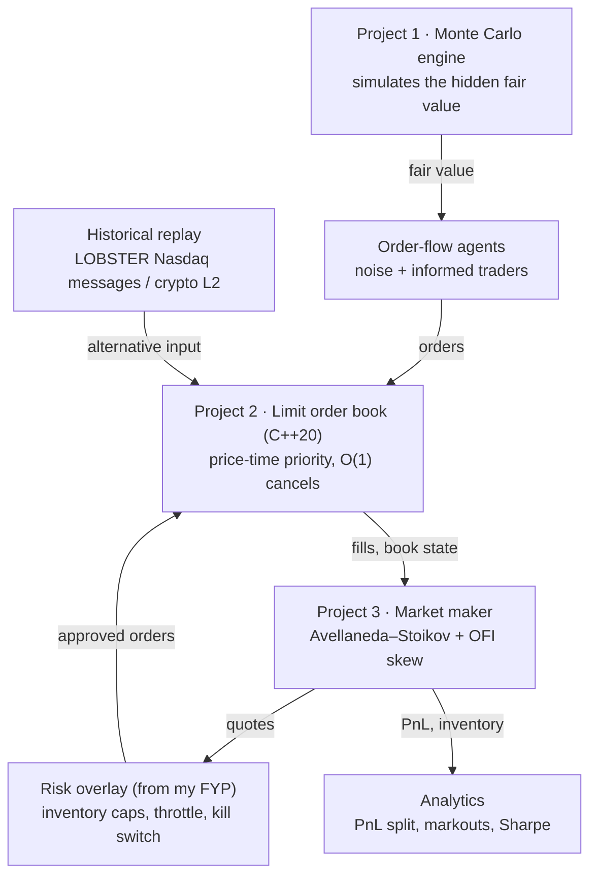

# quant-stack

[](https://github.com/naqi-zaidi/quant-stack/actions/workflows/ci.yml)


**One market-making research system rather than three separate demos.** A Monte Carlo engine simulates a hidden fair value. Agents send orders around it into a C++20 limit order book. A market maker quotes into that book through a risk layer, and analytics score the result.

> **Status:** Phase 1 (foundation) is done. Project 1 step 1 is done, and its gate passes: Monte Carlo prices agree with Black–Scholes, with correctly sized error bars over 1,200 independent runs.

## Results so far

### Monte Carlo vs Black–Scholes (Phase 1 gate)

"Within one standard error" is a coverage claim, so the gate tests coverage. If the estimator is unbiased and its standard error is honest, then z = (MC − BS) / SE is standard normal. That means about 68% of runs should land inside |z| < 1, and 95% inside |z| < 2.

The test reruns 12 contracts (calls and puts; K = 90/100/110; T = 0.5/1y) 100 times each with independent seeds:

| Check (1,200 runs, 50k paths each) | Observed | Expected if SE is right |
|---|---:|---:|
| share inside \|z\| < 1 | 69.2% | 68.3% ± 4.0% |
| share inside \|z\| < 2 | 95.4% | 95.5% ± 1.8% |
| mean z | +0.022 | 0 ± 0.087 |
| sd of z | 0.993 | 1 ± 0.061 |

Bands are 3σ. Coverage well *above* 68% would also fail, because it would mean the error bars are overstated. The single-seed table at 1M paths per contract is printed by `bs_gate`. In that run only 4 of 12 contracts land inside |z| < 1, which is why twelve z-scores alone can't serve as a gate.

### Error falls as 1/√N


Empirical RMSE against the closed form tracks the standard error the estimator reports, at every N from 256 to about 1M paths. The fitted log-log slope is **−0.500** (theory: −½).

## How the pieces connect



## Roadmap

| Phase | Scope | Gate | Status |
|---|---|---|---|
| 0 · Foundation | Monorepo, CMake + uv, CI with ASan/UBSan, LOBSTER loader | CI green | ✅ done |
| 1 · Monte Carlo engine | Pricer with error bars → variance reduction → Greeks → Asian/barrier/American (Longstaff–Schwartz) → Heston → SPY calibration → Numba | MC within its standard error of Black–Scholes | 🟡 step 1 of 7 |
| 2 · Limit order book | C++20 matching engine, property tests, LOBSTER replay, benchmarks, pybind11 | Rebuilt book matches LOBSTER on every event | ⏳ |
| 3 · Market maker | Avellaneda–Stoikov, order-flow-imbalance skew, markouts, risk overlay | Walk-forward, out-of-sample, net of fees | ⏳ |
| 4 · Add-ons | Delta-hedging PnL simulator, Almgren–Chriss execution on the book | — | ⏳ |

## Quickstart

Requires [uv](https://docs.astral.sh/uv/). It fetches Python 3.12 and the pinned dependencies from `uv.lock`.

```bash
git clone https://github.com/naqi-zaidi/quant-stack.git
cd quant-stack
uv sync
uv run pytest                                        # unit + property tests
uv run python -m mc_engine.experiments.bs_gate       # Phase 1 gate tables
uv run python -m mc_engine.experiments.convergence   # regenerates the figure above
```

C++ core (needs CMake ≥ 3.25 and a C++20 compiler):

```bash
cmake --preset asan          # Debug + AddressSanitizer + UBSan, warnings as errors
cmake --build --preset asan
ctest --preset asan
```

On Windows, use the `dev` or `release` preset with Visual Studio Build Tools. The sanitizer preset targets GCC/Clang, and CI runs it on Ubuntu.

```python
from mc_engine import price_european, bs_price

res = price_european(s0=100, k=100, t=1.0, r=0.05, sigma=0.2, n_paths=1_000_000, seed=0)
res.price, res.std_error, res.ci95, res.z_score(bs_price(100, 100, 1.0, 0.05, 0.2))
```

## Layout

```
quant-stack/
  mc_engine/          Project 1: GBM (exact log step), Black–Scholes, Monte Carlo pricer
    experiments/      scripts that produce every number in this README
  lob/                Project 2: C++20 core (types today; matching engine next)
  marketdata/         loaders: LOBSTER today; crypto L2 and option chains with later phases
  tests/              pytest + Hypothesis property tests
  data/               local market data, git-ignored (see data/README.md)
  docs/figures/       figures referenced above
  .github/workflows/  CI: lint, tests, gate, C++ under ASan/UBSan and Release
```

## Standards every component meets

- **Reproducible:** fixed seeds (`SeedSequence.spawn` for independent streams), pinned `uv.lock`, derandomized property tests. Every number above comes from one command.
- **Error bars on every headline number:** Monte Carlo tolerances are stated in standard errors, never as fixed decimals.
- **Invariants, not just examples:** put–call parity, no-arbitrage bounds and vega ≥ 0 are checked across hundreds of generated parameter sets. LOBSTER files are checked for row alignment, monotone time and an uncrossed book.
- **Production habits in C++:** integer tick prices (no floating-point price comparisons), `-Wall -Wextra -Wconversion -Werror`, and AddressSanitizer + UBSan in CI.

## Current limitations

- Plain Monte Carlo only. Antithetic, control-variate and Sobol estimators are the next step, and each will report its variance-reduction factor against this baseline.
- GBM dynamics only. Jumps (Merton) and stochastic volatility (Heston) arrive in steps 5 and 6.
- The C++ side holds only shared types and the build/test/sanitizer pipeline. The matching engine is Phase 2.

## License

MIT
