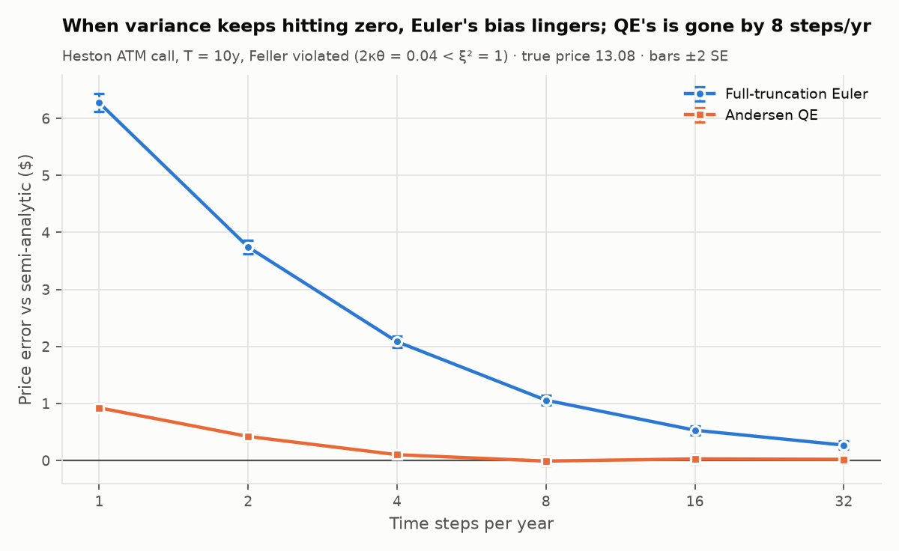
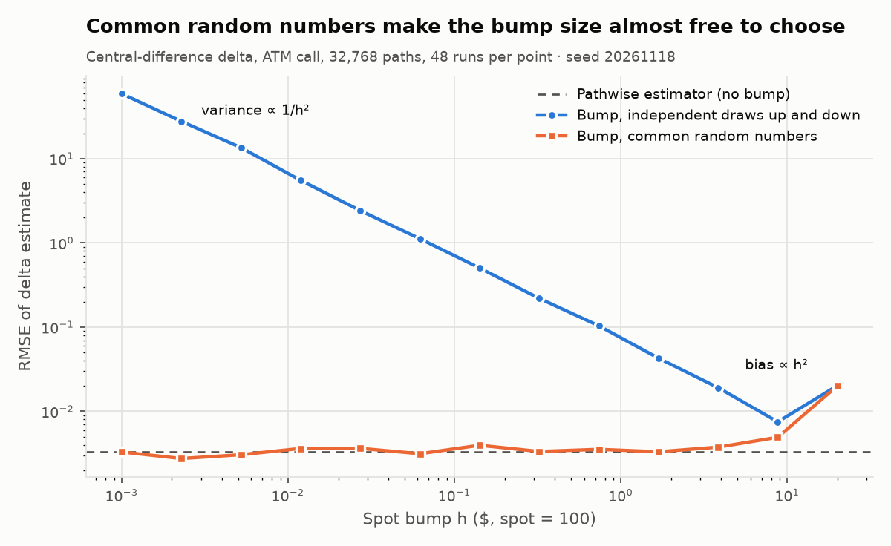
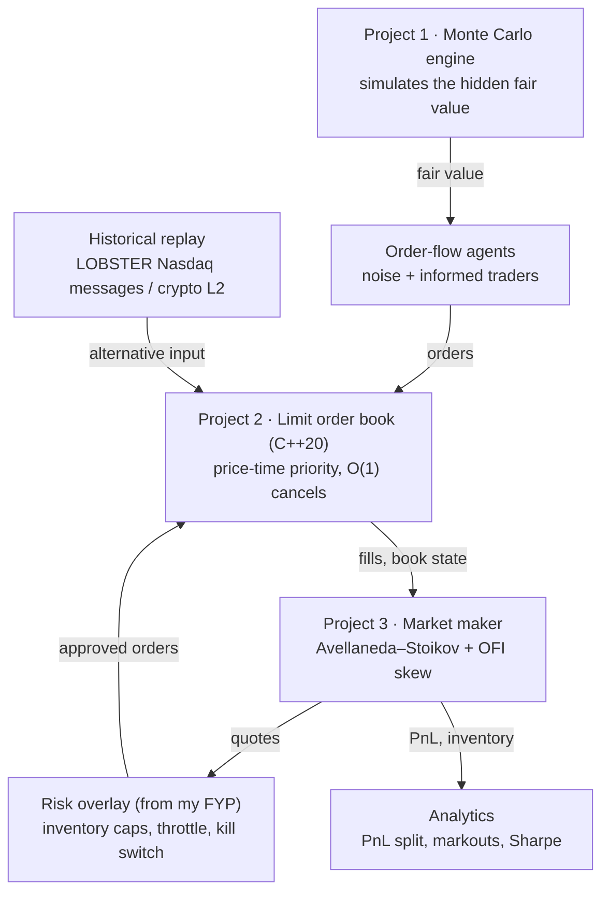

# quant-stack

[](https://github.com/naqi-zaidi/quant-stack/actions/workflows/ci.yml)


**One market-making research system rather than three separate demos.** A Monte Carlo engine simulates a hidden fair value. Agents send orders around it into a C++20 limit order book. A market maker quotes into that book through a risk layer, and analytics score the result.

> **Status:** Foundation done. **Project 1 (Monte Carlo engine) is complete.** Phase 2, the C++ limit order book, is next.
> - **Step 7 (speed):** Numba kernels run 1.5–2.4× faster than vectorised NumPy on 2 cores, and give bit-identical results at any thread count.
> - **Step 6 (calibration):** Heston fitted to a real SPY option snapshot (2,874 quotes, 22 expiries) prices **held-out strikes to within 0.47 implied-vol points**, against 5.6 for a single flat volatility.
> - **Step 5 (beyond GBM):** Merton jump-diffusion and Heston stochastic volatility. The semi-analytic Heston pricer matches **published benchmark values to within 2×10⁻⁷**, and Andersen's QE scheme removes the time-step bias that Euler still shows at 32 steps a year.
> - **Step 4 (path-dependent):** an arithmetic Asian priced with **16,000× less variance** than plain Monte Carlo; a barrier option with **no monitoring bias at any grid size**; and American puts by Longstaff–Schwartz, **within 1% of a binomial reference**.
> - **Step 3 (Greeks):** delta and vega from three estimators all land within 4 standard errors of Black–Scholes. The pathwise estimator's known failure on digital options is shown, not hidden.
> - **Step 2 (variance reduction):** on an at-the-money call at equal path count, variance falls **2.5× (antithetic), 5.3× (control variate) and about 2,200× (randomized Sobol)**.
>
> CI runs a gate for every step.

## Results so far

### Speed: NumPy vs Numba (Project 1, step 7)

Three kernels, each priced by the package's vectorised NumPy code and by a Numba version compiled for one thread and for all threads. Timings are best of 3 after warm-up, on a 2-vCPU cloud machine (`mc_engine.experiments.speed`):

| Kernel | NumPy | Numba serial | Numba parallel (2 threads) | Parallel vs NumPy |
|---|---:|---:|---:|---:|
| European call (1 draw per path) | 42M paths/s | 33M | 64M | 1.5× |
| Arithmetic Asian, 252 steps | 133k paths/s | 145k | 293k | 2.2× |
| Heston QE, 252 steps (2 draws + a branch per step) | 66k paths/s | 79k | 160k | 2.4× |

Every benchmarked price is checked before its timing counts: within 4 standard errors of the closed form or reference, and serial vs parallel bit-identical. On the same input normals, the Numba kernels reproduce the NumPy code exactly (`tests/test_fast.py`). Compiling all six kernels takes about 3.6 s once per process.

**Where the time goes.** Single-threaded Numba barely beats NumPy, and loses on the European, because of random number generation, not the model:

| Share of runtime spent drawing normals | NumPy (PCG64 + ziggurat) | Numba (xoshiro256** + Box–Muller) |
|---|---:|---:|
| European call | 66% | 70% |
| Arithmetic Asian | 46% | 74% |
| Heston QE | 46% | 84% |

With the generator taken out, Numba runs the model arithmetic about 2.3× faster than NumPy for the Asian and 4× faster for Heston. There are no 252-column intermediate arrays and no masked branches. Box–Muller, at a log, a sqrt and a sin/cos pair for every two normals, gives most of that back against NumPy's ziggurat. A ziggurat or fast inverse-CDF normal generator is the obvious next speed-up.

**Three bugs found on the way to parallel speed:**
1. **Built-in generator in parallel loops:** Numba's `np.random` has to look up the current thread's generator state on every draw, which made the parallel build 2.3× slower per thread. Fix: an explicit xoshiro256** generator whose state lives in local variables, seeded per block of 4,096 paths.
2. **Code inside the parallel loop:** writing the whole loop body inside `prange` was optimised worse than the same code in its own function. Fix: a trivial `prange` loop over blocks that calls a normally compiled per-block function.
3. **Shared cache entry:** compiling the serial and parallel builds from one function with `cache=True` gave them the same on-disk cache entry, so the "parallel" kernel silently loaded the serial machine code. Fix: the two-variant drivers aren't cached.

Because each block of paths always runs start to finish on one thread with its own seed, results don't depend on the thread count.

### Heston calibrated to SPY (Project 1, step 6)

**Data.** A real SPY option-chain snapshot taken 2026-11-19 at 10:03 New York time. It's committed in [`data/snapshots/`](data/snapshots) so the fit reproduces exactly. The surface is built in three steps:
1. **Forwards** per expiry come from put-call parity at the money. They agree across strikes to a median of $0.90.
2. **Quotes** are kept only if they're out-of-the-money, between 14 days and 2.2 years to expiry, with a positive bid and a spread of at most 50% of mid. That leaves 2,874 quotes across 22 expiries.
3. **Implied vols** come from Black-76 on the forward, discounted at a flat 3.9% (30-day average SOFR).

Every 4th strike of each expiry is held out, so the fit sees 2,164 quotes.

| Model | In-sample RMSE | Held-out RMSE |
|---|---:|---:|
| One flat vol (Black–Scholes) | 5.87 | 5.64 |
| Flat vol per expiry (term structure, no smile) | 5.73 | 5.49 |
| **Heston, 5 parameters** | **0.51** | **0.47** |

Errors are in implied-vol points (1.00 = 1% vol). Both baselines are fitted on the same in-sample quotes.


**Fitted parameters.** κ = 3.72, long-run vol √θ = 23.5%, spot vol √v0 = 20.8%, ρ = −0.73 and vol-of-vol ξ = 1.35. That violates the Feller condition (2κθ = 0.41 vs ξ² = 1.82), which is typical for equity-index fits. Four different starting points all converge to the same parameters to four decimal places, so the fit is identified rather than one of many local optima. The CI gate makes this a checked property: quotes regenerated from the fitted parameters on SPY's own strike grid, using the independent adaptive-quadrature pricer, must calibrate back to them.

**Where Heston misses.** Errors are smallest from 3 months to 1.2 years, at 0.29–0.45 vol points held out. They grow at both ends:
- At 2 weeks (0.55–0.76), the market's deep-put wing is steeper than any diffusion can produce over so short a horizon. That's the standard argument for adding jumps (Bates = Heston + Merton).
- At 2 years (0.65–0.77), one mean-reverting variance factor can't match both the short- and long-dated skew.

**How it's fast enough to calibrate.** The step-5 pricer uses adaptive quadrature, one strike at a time. The calibrator instead evaluates the characteristic function once per expiry on a Gauss–Legendre grid and reuses it for every strike: about 2 ms per 200-strike expiry, and about 9 s for a full 4-start calibration.

The grid adapts to the parameters. When Feller is badly violated, the characteristic function decays only exponentially, and a fixed cutoff was off by up to $0.19 per option. So the cutoff doubles until |φ| < 1e-12, and the node count follows a measured rule. The result agrees with the adaptive pricer to within 1.2×10⁻¹⁰ of the forward.

### Beyond GBM: jumps and stochastic volatility (Project 1, step 5)

Black–Scholes gives every strike the same implied vol. Real option markets show a skew, with downside strikes dearer, and both models below produce one for a different reason. Everything comes from `mc_engine.experiments.models`, and its gate runs in CI.

**Merton jump-diffusion** adds Poisson-timed jumps with lognormal sizes to GBM. Conditional on the number of jumps, the log-price is normal, so the closed form is a Poisson-weighted sum of Black–Scholes prices. The simulation is exact, with no time grid, and agrees with the series at every strike (all |z| < 0.8). With negative mean jumps (λ = 0.5/yr, mean log jump −10%), implied vol runs from 22.7% at K = 70 to 17.9% at K = 130.

**Heston stochastic volatility** lets variance follow its own mean-reverting process, correlated with the stock. Its characteristic function is known in closed form ("little Heston trap" form), so European prices follow by Fourier inversion. That pricer is checked against published benchmark values:

| Case (S0 = K = 100, T = 1y, r = 3%, κ = 2, ξ = 0.35, ρ = −0.7) | Benchmark | This repo | Difference |
|---|---:|---:|---:|
| v0 = 0.01, θ = 0.04 | 7.85571767 | 7.85571767 | +4.8e−09 |
| v0 = 0.09, θ = 0.04 | 10.99728901 | 10.99728903 | +1.7e−08 |
| v0 = 0.04, θ = 0.01 | 7.26603514 | 7.26603498 | −1.6e−07 |
| v0 = 0.04, θ = 0.09 | 11.56109741 | 11.56109743 | +2.0e−08 |

Benchmarks are from arXiv:2606.13992, Table 4. The largest gap matches the paper's own disagreement between its two methods. Further checks:
- As vol-of-vol goes to 0, the price converges to Black–Scholes at the effective vol, with the gap shrinking in proportion to ξ.
- With ρ = −0.7, implied vol runs from 26.6% at K = 70 to 14.2% at K = 130, and QE simulation matches the semi-analytic price at all seven strikes.



**Why the simulation scheme matters.** Heston paths can't be simulated exactly with a plain time-stepping scheme. The variance can hit zero, and when the Feller condition 2κθ ≥ ξ² fails it does so constantly. Full-truncation Euler clips the variance at zero and pays for it in bias. Andersen's QE scheme matches the first two moments of each variance step, using a point mass at zero plus an exponential near zero:

| Steps per year (ATM call, T = 10y, 2κθ = 0.04 vs ξ² = 1) | Euler bias | QE bias |
|---:|---:|---:|
| 1 | +6.27 (z = +79) | +0.92 (z = +26) |
| 4 | +2.08 (z = +44) | +0.10 (z = +2.8) |
| 8 | +1.06 (z = +26) | −0.01 (z = −0.3) |
| 32 | +0.27 (z = +7) | +0.02 (z = +0.6) |

The true price is 13.0847. Euler's bias halves each time the step count doubles, as a first-order scheme's should, but at 32 steps a year it's still 7σ off. QE is within noise from 8 steps a year.

### Path-dependent payoffs (Project 1, step 4)

Each payoff is checked against a reference that isn't itself Monte Carlo wherever one exists. Everything comes from `mc_engine.experiments.path_dependent`, and its gate runs in CI.

**Asian call (monthly average, S0 = K = 100, σ = 25%, T = 1y).** The geometric-average Asian has an exact closed form, 6.9907. Monte Carlo reproduces it (z = −0.97 pseudo-random, +0.16 Sobol), which validates the path engine. That same closed form then serves as a control variate for the arithmetic average, which has no closed form:

| Arithmetic Asian, 16,384 paths | Variance reduction vs plain | worst \|z\| vs reference, 100 runs |
|---|---:|---:|
| Plain MC | 1× | 2.41 |
| Geometric control variate | 832× | 3.34 |
| Sobol + Brownian bridge | 392× | 3.71 |
| Sobol + bridge + control variate | **16,216×** | 2.66 |

The reference is 7.31244 ± 0.00005 (Sobol + bridge + control variate, about 1M paths). The arithmetic price sits above the geometric one, as it must: the arithmetic mean is never below the geometric mean.

**Down-and-out call (S0 = K = 100, barrier 90, continuous monitoring).** A simulated path is only seen on its grid, so it can cross the barrier between grid points without being knocked out. Naive monitoring therefore overprices. The Brownian-bridge correction weights each path by its exact probability of not having crossed between grid points, which removes the bias at any grid size:


| Grid steps | Naive MC | BGK formula (theory) | Bridge-corrected MC | Closed form |
|---:|---:|---:|---:|---:|
| 4 | 11.4002 | 11.3652 | 9.1205 (z = +0.20) | 9.1112 |
| 64 | 9.8975 | 9.8930 | 9.1148 (z = +0.07) | 9.1112 |
| 256 | 9.5880 | 9.5241 | 9.1191 (z = +0.16) | 9.1112 |

Naive Monte Carlo is not broken. It correctly prices a barrier checked only on the grid, and it agrees with the Broadie–Glasserman–Kou formula for that case to within about one standard error. The gap to continuous monitoring shrinks only slowly: the fitted slope is −0.39, against −0.41 predicted by BGK over the same grids, and −½ only on much finer grids.

**American put (K = 40, r = 6%, T = 1y, 50 exercise dates).** Longstaff–Schwartz regresses future cash flows on cubic polynomials in S/K, using in-the-money paths only. Evaluating the fitted rule on the same paths it was fitted on lets it partly see their futures. So the price uses fresh paths: a rule fitted on one set and applied to an independent set is a true lower bound. The reference is a binomial tree (Black–Scholes smoothing + Richardson extrapolation) with the same 50 exercise dates.

| S0 | σ | European | Bermudan-50 (tree) | American (tree) | LSM out-of-sample | vs tree |
|---:|---:|---:|---:|---:|---:|---:|
| 36 | 0.2 | 3.8443 | 4.4778 | 4.4867 | 4.4837 ± 0.0114 | +0.0059 |
| 36 | 0.4 | 6.7114 | 7.1013 | 7.1090 | 7.0460 ± 0.0234 | −0.0553 |
| 40 | 0.2 | 2.0664 | 2.3141 | 2.3196 | 2.3241 ± 0.0108 | +0.0100 |
| 40 | 0.4 | 5.0596 | 5.3120 | 5.3183 | 5.3257 ± 0.0222 | +0.0137 |
| 44 | 0.2 | 1.0169 | 1.1099 | 1.1130 | 1.1012 ± 0.0081 | −0.0087 |
| 44 | 0.4 | 3.7828 | 3.9477 | 3.9528 | 3.9304 ± 0.0202 | −0.0173 |

The gate checks two things. No out-of-sample price may sit meaningfully above the tree, since that would break the lower bound. None may sit more than 1% below it, which would mean a poor exercise rule. The worst case is −0.8% (σ = 0.4, S0 = 36). The tree itself matches Black–Scholes to 2e-5 for European exercise, and its American call with no dividends equals the European call, as theory requires.

### Greeks (Project 1, step 3)

Delta and vega are computed from the same paths by three estimators, each with its own standard error:

| Estimator | How it works | Breaks when |
|---|---|---|
| **Pathwise** | differentiates the payoff along each path | payoff is discontinuous (digitals, barriers) |
| **Likelihood ratio** | differentiates the probability density instead | maturity is short and the option is away from the money (variance explodes) |
| **Bump + CRN** | reprices at ±h reusing the same random numbers | h is too large (O(h²) bias) |

Results at 262,144 paths (σ = 25%, T = 1y). Each cell is the estimate with its z-score against the closed form:

| Contract | Greek | Black–Scholes | Pathwise | Likelihood ratio | Bump + CRN |
|---|---|---:|---:|---:|---:|
| call K=80 | delta | 0.8718 | 0.8711 (−0.8) | 0.8755 (+1.0) | 0.8709 (−1.0) |
| call K=100 | delta | 0.6061 | 0.6055 (−0.5) | 0.6022 (−1.4) | 0.6052 (−0.7) |
| call K=100 | vega | 37.9253 | 37.7010 (−1.5) | 37.2273 (−1.3) | 37.7024 (−1.5) |
| put K=100 | delta | −0.3840 | −0.3841 (−0.2) | −0.3859 (−1.2) | −0.3840 (−0.1) |
| digital call K=100 | delta | 0.0152 | **0.0000 ✗** | 0.0152 (+0.5) | 0.0151 (−0.6) |
| digital call K=100 | vega | −0.4323 | **0.0000 ✗** | −0.4364 (−0.6) | −0.4278 (+0.5) |

The full 10-row table comes from `mc_engine.experiments.greeks`, and all 28 valid cells pass the 4σ gate in CI.

On the digital, pathwise returns exactly 0 with a standard error of 0. The payoff's derivative is zero almost everywhere, so the estimator is confidently wrong. The likelihood ratio handles it because it never differentiates the payoff.

**When the likelihood ratio becomes unusable.** Its weights grow like 1/(σ√T), so it can't be used at short maturities away from the money. At the money the call payoff also shrinks like √T, which cancels the growth, and the delta variance ratio converges to exactly 5:

| LR variance ÷ pathwise variance | T=2 | T=1 | T=0.25 | T=0.05 | T=0.01 |
|---|---:|---:|---:|---:|---:|
| ITM call (K=80), delta | 11.7× | 17.6× | 110× | 4,863× | 106,702× |
| ATM call (K=100), delta | 6.0× | 5.9× | 5.4× | 5.2× | 5.0× |



**Bumping needs common random numbers.** With independent draws up and down, the finite-difference variance grows like 1/h². At a $0.001 bump the delta error is about 59, against a true value of 0.6. Reusing the same draws keeps the error flat at the pathwise level, from h = $0.001 up to about $4, until O(h²) bias takes over.

### Variance reduction (Project 1, step 2)

Variance-reduction factor (VRF) = Var(plain estimates) / Var(method estimates) at the same number of paths. Each factor comes from 200 independent runs per method, not from the method's own reported error.

| Method (16,384 paths) | call K=80 (ITM) | call K=100 (ATM) | call K=130 (OTM) | put K=100 (ATM) |
|---|---:|---:|---:|---:|
| Antithetic | 10.5× | 2.5× | 1.2× | 1.7× |
| Control variate (S_T) | 64.8× | 5.3× | 1.7× | 2.7× |
| Sobol RQMC (16 scramblings) | 2,853× | 2,190× | 401× | 12,762× |

S = 100, σ = 20%, T = 1y, r = 5%. Each factor's 95% CI runs from about ×0.76 to ×1.32 of the value shown.

Antithetic and the S_T control both work only when the payoff moves almost linearly with S_T. That's why they're strong deep in the money and fade out of the money, where most paths pay zero. Sobol doesn't depend on payoff shape. Its error falls at about 1/N against 1/√N for the others, so its lead grows with N.


**At equal wall-clock** (ATM call, 262,144 paths, single core, best of 5):

| Method | Time | VRF | Efficiency gain |
|---|---:|---:|---:|
| Plain MC | 5.1 ms | 1.0× | 1.0× |
| Antithetic | 3.4 ms | 2.5× | 3.7× |
| Control variate (S_T) | 5.9 ms | 5.3× | 4.6× |
| Sobol RQMC | 9.3 ms | 2,190× | 1,209× |

Antithetic gains more than its VRF because it draws half as many normals.

**Why the Brownian bridge matters.** Path-dependent payoffs need multi-step paths, and each step uses another Sobol dimension. Sobol's later dimensions are much less uniform than its first few. Built step by step, a 64-step path spreads S_T across all 64 dimensions and loses nearly all the QMC gain. The bridge sets W_T from the first dimension and fills in midpoints after, which restores it:

| ATM call from 64-step Sobol paths (50 runs each) | VRF vs plain |
|---|---:|
| 1 step, terminal draw only (reference) | 1,657× |
| 64 steps, standard construction | 20× |
| 64 steps, Brownian bridge | 1,122× |

**Honest error bars.** Each estimator computes its standard error in its own way:
- Antithetic uses pair averages, because the two halves of a pair are correlated.
- The control variate takes beta from an independent pilot run, since fitting it in-sample adds O(1/N) bias.
- Sobol uses the spread across 16 independent scramblings, with Student's t quantiles.

CI checks all four against their observed spread over 800 runs each:

| Method | mean SE² / observed variance | inside \|z\| < 1 | inside \|z\| < 2 |
|---|---:|---:|---:|
| Plain MC | 0.94 | 68.9% | 94.9% |
| Antithetic | 1.07 | 69.5% | 95.0% |
| Control variate (S_T) | 0.92 | 67.5% | 93.0% |
| Sobol RQMC | 1.06 | 67.5% | 93.9% |

Expected values are 1, 68.3% ± 6.6% and 95.5% ± 2.9%, with bands at 4σ. That width is deliberate. The gate makes 12 checks, and at 3σ a correct estimator would fail one of them about 3% of the time. That happened once in development to the control variate, and 8,000 fresh runs confirmed it was calibrated. [`test_calibration_gate.py`](tests/test_calibration_gate.py) shows the 4σ gate never fails honest error bars and rejects any that are 20% too small or too large.

### Monte Carlo vs Black–Scholes (step 1 gate)

"Within one standard error" is a coverage claim, so the gate tests coverage. If the estimator is unbiased and its standard error is honest, then z = (MC − BS) / SE is standard normal. That means about 68% of runs should land inside |z| < 1, and 95% inside |z| < 2.

The test reruns 12 contracts (calls and puts; K = 90/100/110; T = 0.5/1y) 100 times each with independent seeds:

| Check (1,200 runs, 50k paths each) | Observed | Expected if SE is right |
|---|---:|---:|
| share inside \|z\| < 1 | 69.2% | 68.3% ± 4.0% |
| share inside \|z\| < 2 | 95.4% | 95.5% ± 1.8% |
| mean z | +0.022 | 0 ± 0.087 |
| sd of z | 0.993 | 1 ± 0.061 |

Bands are 3σ. Coverage well *above* 68% would also fail, because it would mean the error bars are overstated. The single-seed table at 1M paths per contract is printed by `bs_gate`. In that run only 4 of 12 contracts land inside |z| < 1, which is why twelve z-scores alone can't serve as a gate.

### Error falls as 1/√N


Empirical RMSE against the closed form tracks the standard error the estimator reports, at every N from 256 to about 1M paths. The fitted log-log slope is **−0.500** (theory: −½).

## How the pieces connect



## Roadmap

| Phase | Scope | Gate | Status |
|---|---|---|---|
| 0 · Foundation | Monorepo, CMake + uv, CI with ASan/UBSan, LOBSTER loader | CI green | ✅ done |
| 1 · Monte Carlo engine | Pricer with error bars ✅ → variance reduction ✅ → Greeks ✅ → Asian/barrier/American (Longstaff–Schwartz) ✅ → Merton + Heston ✅ → SPY calibration ✅ → Numba ✅ | MC within its standard error of Black–Scholes | ✅ done |
| 2 · Limit order book | C++20 matching engine, property tests, LOBSTER replay, benchmarks, pybind11 | Rebuilt book matches LOBSTER on every event | ⏳ |
| 3 · Market maker | Avellaneda–Stoikov, order-flow-imbalance skew, markouts, risk overlay | Walk-forward, out-of-sample, net of fees | ⏳ |
| 4 · Add-ons | Delta-hedging PnL simulator, Almgren–Chriss execution on the book | — | ⏳ |

## Quickstart

Requires [uv](https://docs.astral.sh/uv/). It fetches Python 3.12 and the pinned dependencies from `uv.lock`.

```bash
git clone https://github.com/naqi-zaidi/quant-stack.git
cd quant-stack
uv sync
uv run pytest                                        # unit + property tests
uv run python -m mc_engine.experiments.bs_gate             # step 1 gate tables
uv run python -m mc_engine.experiments.convergence         # 1/√N figure
uv run python -m mc_engine.experiments.variance_reduction  # step 2 tables + figure (~20 s)
uv run python -m mc_engine.experiments.greeks              # step 3 tables + figure
uv run python -m mc_engine.experiments.path_dependent      # step 4 tables + figure (~20 s)
uv run python -m mc_engine.experiments.models              # step 5 tables + figure (~25 s)
uv run python -m mc_engine.experiments.calibration         # step 6: Heston fit to SPY (~20 s)
uv run python -m mc_engine.experiments.speed               # step 7: NumPy vs Numba throughput (~30 s)
```

C++ core (needs CMake ≥ 3.25 and a C++20 compiler):

```bash
cmake --preset asan          # Debug + AddressSanitizer + UBSan, warnings as errors
cmake --build --preset asan
ctest --preset asan
```

On Windows, use the `dev` or `release` preset with Visual Studio Build Tools. The sanitizer preset targets GCC/Clang, and CI runs it on Ubuntu.

```python
from mc_engine import price_european, bs_price

res = price_european(s0=100, k=100, t=1.0, r=0.05, sigma=0.2, n_paths=1_000_000, seed=0)
res.price, res.std_error, res.ci95, res.z_score(bs_price(100, 100, 1.0, 0.05, 0.2))

# Same call, variance-reduced: method = "antithetic" | "control_variate" | "sobol"
price_european(
    100, 100, 1.0, 0.05, 0.2, n_paths=1 << 16, method="sobol", n_steps=64, construction="bridge"
)

# Delta and vega by pathwise, likelihood ratio and bump + CRN, from one set of paths
from mc_engine.greeks import mc_greeks

g = mc_greeks(100, 100, 1.0, 0.05, 0.2, kind="call")
g.delta["pathwise"], g.vega["likelihood_ratio"]

# Path-dependent payoffs
from mc_engine.american import lsm_price, tree_price
from mc_engine.asian import price_asian
from mc_engine.barrier import price_down_and_out_call

price_asian(100, 100, 1.0, 0.05, 0.25, n_steps=12, control_variate=True, sampler="sobol")
price_down_and_out_call(100, 100, 90, 1.0, 0.05, 0.25, n_steps=16)  # bridge-corrected
lsm_price(36, 40, 1.0, 0.06, 0.2), tree_price(36, 40, 1.0, 0.06, 0.2, exercise=50)

# Beyond GBM
from mc_engine.heston import HestonParams, heston_price, price_heston_mc
from mc_engine.implied_vol import implied_vol

p = HestonParams(kappa=2.0, theta=0.04, xi=0.5, rho=-0.7, v0=0.04)
price = heston_price(100, 90, 1.0, 0.05, p)  # semi-analytic
implied_vol(price, 100, 90, 1.0, 0.05), price_heston_mc(100, 90, 1.0, 0.05, p, scheme="qe")

# Calibrate Heston to the committed SPY snapshot
from marketdata.option_chain import build_surface, load_yfinance_snapshot
from mc_engine.heston_calibration import calibrate

surface = build_surface(
    load_yfinance_snapshot("data/snapshots/spy_options_2026-11-19.csv.gz"), rate=0.039
)
calibrate(surface).params

# Same prices, compiled: serial or multi-threaded, identical results either way
from mc_engine.fast import price_heston_numba

price_heston_numba(100, 100, 1.0, 0.05, p, n_steps=252, n_paths=1 << 18, parallel=True)
```

## Layout

```
quant-stack/
  mc_engine/          Project 1: GBM (exact log step), Black–Scholes, Monte Carlo pricer,
                      variance reduction, Brownian bridge + scrambled Sobol, Greeks,
                      Asian / barrier / American (Longstaff–Schwartz + binomial reference),
                      Merton jump-diffusion, Heston (semi-analytic, Euler, QE), implied vol,
                      fast Heston surface pricer + calibration, Numba kernels (fast.py)
    experiments/      scripts that produce every number in this README
  lob/                Project 2: C++20 core (types today; matching engine next)
  marketdata/         loaders: LOBSTER, option-chain snapshots → implied-vol surface
  tests/              pytest + Hypothesis property tests
  data/               market data: committed snapshots in data/snapshots/, the rest git-ignored
  docs/figures/       figures referenced above
  .github/workflows/  CI: lint, tests, gate, C++ under ASan/UBSan and Release
```

## Standards every component meets

- **Reproducible:** fixed seeds (`SeedSequence.spawn` for independent streams), pinned `uv.lock`, derandomized property tests. Every number above comes from one command.
- **Error bars on every headline number:** Monte Carlo tolerances are stated in standard errors, never as fixed decimals.
- **Invariants, not just examples:** put–call parity, no-arbitrage bounds and vega ≥ 0 are checked across hundreds of generated parameter sets. LOBSTER files are checked for row alignment, monotone time and an uncrossed book.
- **Production habits in C++:** integer tick prices (no floating-point price comparisons), `-Wall -Wextra -Wconversion -Werror`, and AddressSanitizer + UBSan in CI.

## Current limitations

- Barriers: only the down-and-out call with barrier ≤ strike has a closed form here. The bridge correction works for any single barrier, but the other cases have no reference yet.
- Longstaff–Schwartz gives a lower bound only, with a fixed cubic basis. An Andersen–Broadie duality upper bound would bracket the true price from both sides.
- Timings come from one machine: a 2-vCPU cloud container here. The variance-reduction factors and correctness results are machine-independent, and the throughput figures aren't. Parallel scaling was only measured up to 2 threads; rerun `mc_engine.experiments.speed` on more cores.
- The QE scheme runs without Andersen's martingale correction, so a small residual drift remains. It's within noise at 8+ steps a year in the test above.
- SPY options are American; the calibration treats them as European. Using out-of-the-money quotes only keeps the early-exercise premium small, but doesn't remove it.
- One snapshot, flat discounting at 3.9%. Forwards come from parity, so the dividend yield is never needed. A term structure of rates would barely move the vols.
- Heston can't produce the steep 2-week skew. Adding jumps (Bates) is the natural next model.
- The C++ side holds only shared types and the build/test/sanitizer pipeline. The matching engine is Phase 2.

## License

MIT
