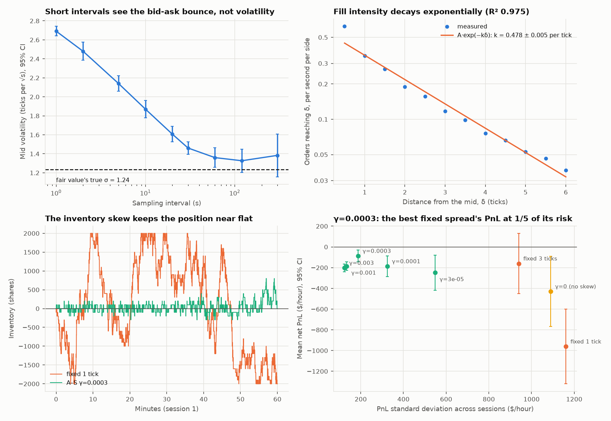
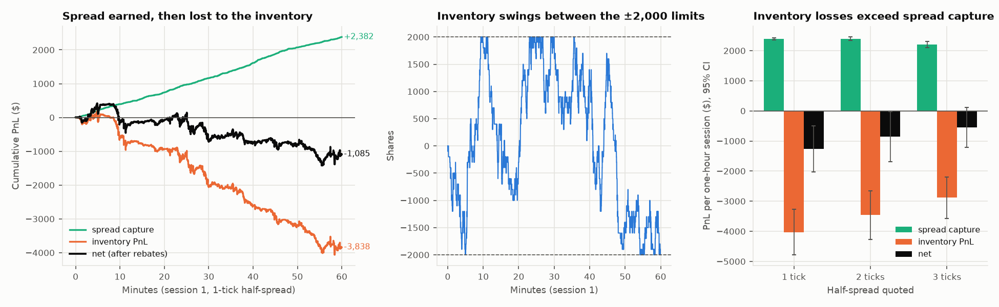
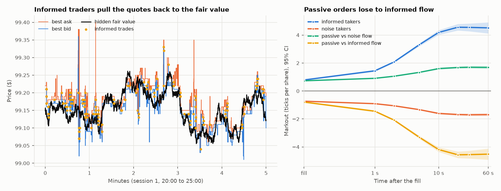
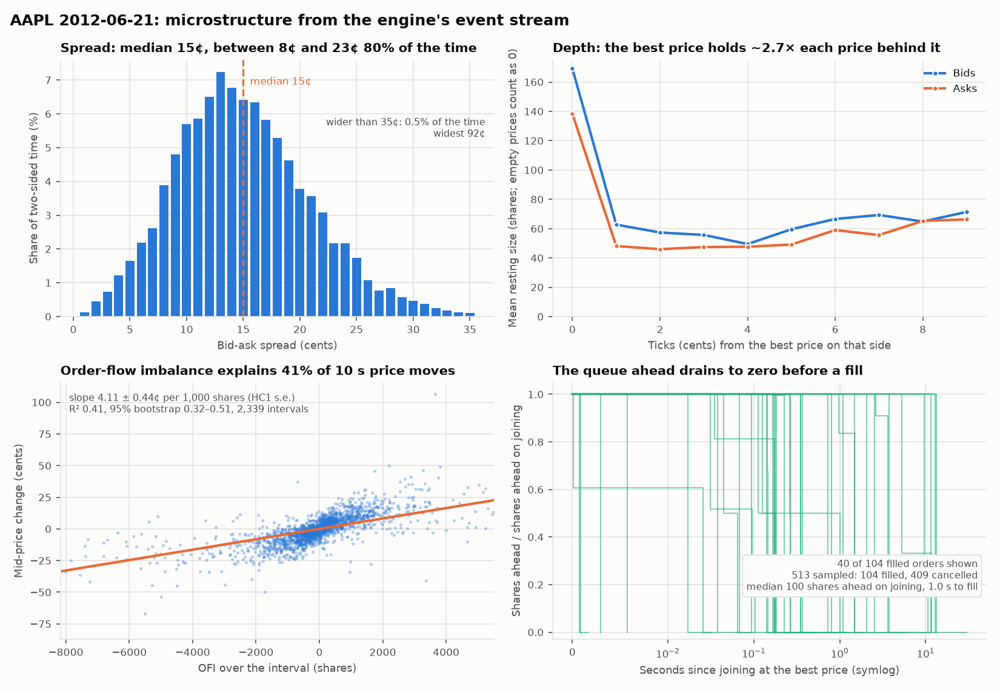
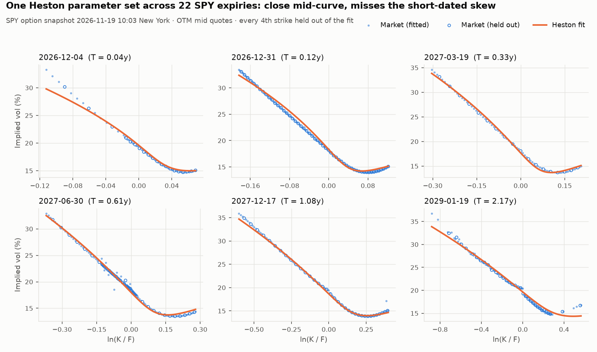
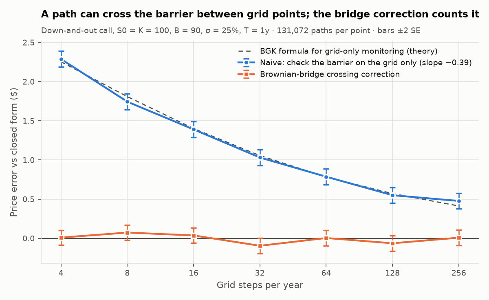
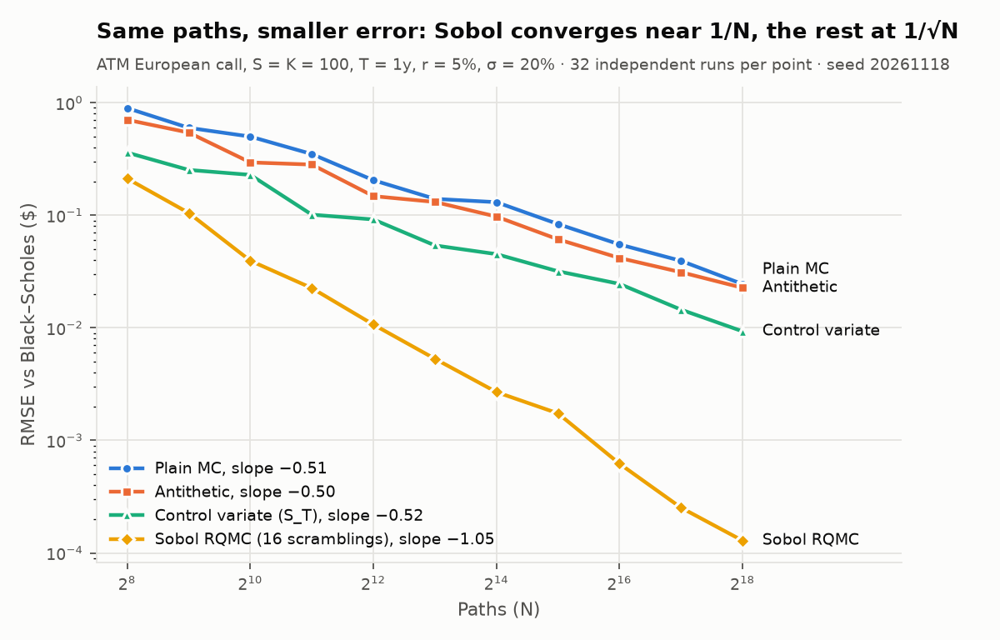
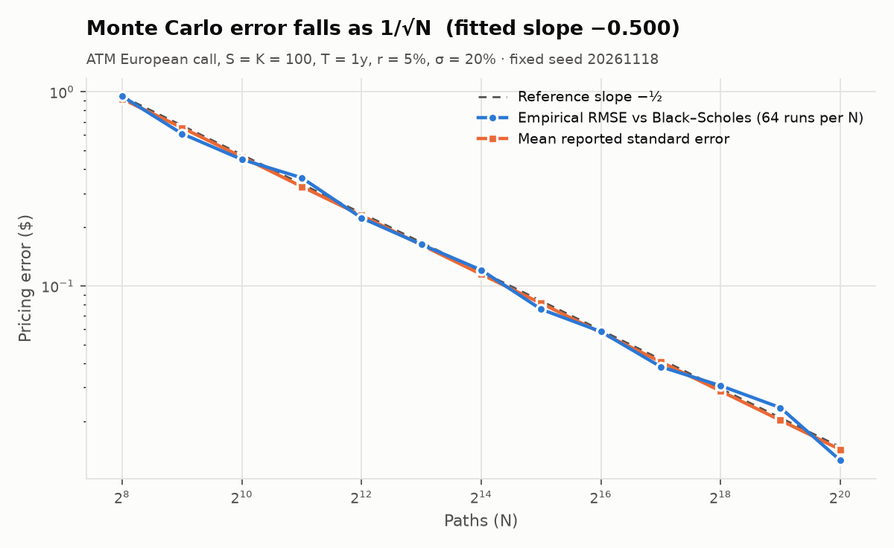
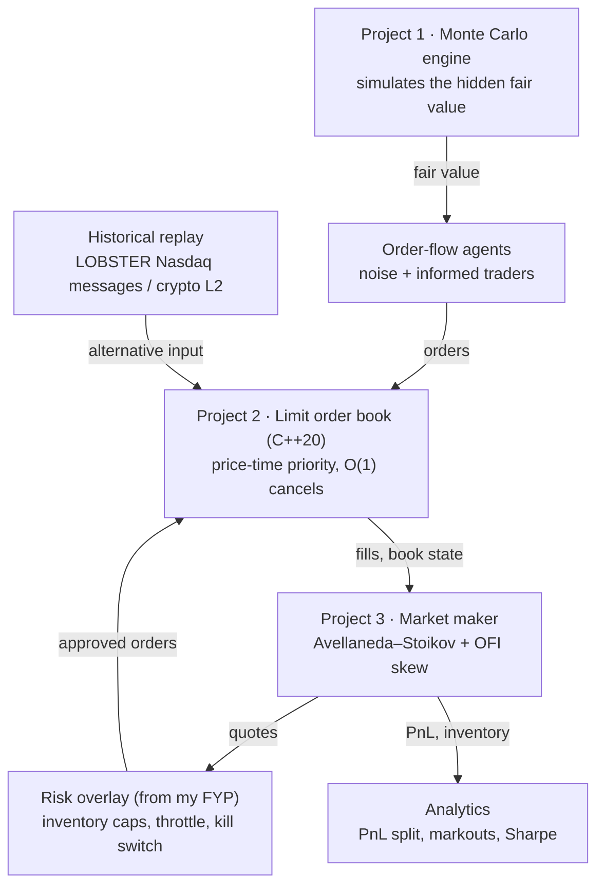

# quant-stack

[](https://github.com/naqi-zaidi/quant-stack/actions/workflows/ci.yml)


**One market-making research system rather than three separate demos.** A Monte Carlo engine simulates a hidden fair value. Agents send orders around it into a C++20 limit order book. A market maker quotes into that book through a risk layer, and analytics score the result.

> **Status:** Foundation done. **Project 1 (Monte Carlo engine) and Project 2 (C++20 limit order book) are complete.** **Project 3, the market maker, is under way.**
> - **Project 3, step 3 (Avellaneda–Stoikov):** calibrated to the market (σ, and the fill-intensity decay k). Its inventory skew cuts mean inventory from about 1,000 shares to 99 (t = −32), and PnL risk to a fifth of the best fixed spread's at the same mean PnL. It beats the 1-tick spread by $874 ± 180 an hour, but it still loses $87 ± 30 an hour to informed flow.
> - **Project 3, step 2 (market-making harness):** a maker quotes through the C++ book. Its books reconcile exactly with the engine's trade record, and PnL splits exactly into spread capture, inventory PnL and fees. A fixed-spread baseline captures about $2,400 an hour in spread but loses more than that on its inventory; Avellaneda–Stoikov's inventory skew comes next.
> - **Project 3, step 1 (synthetic market):** Project 1's Monte Carlo engine simulates a hidden fair value, and noise and informed traders send orders into the C++ book. The mid stays a median 2.2 ticks from the fair value. Adverse selection is measurable: passive orders lose 4.2 ± 0.1 ticks per share over 10 seconds when they trade with informed flow (t = −51).
> - **Project 2, step 6 (microstructure analytics):** spread distribution, depth profile, order-flow imbalance and queue positions, each a C++ listener that rebuilds its own view of the book from the event stream alone. On the AAPL day, all of them match the same statistics computed directly from LOBSTER's own book file, exactly. Order-flow imbalance explains 41% of 10-second price moves (95% CI 33–51%).
> - **Project 2, step 5 (Python module):** `uv sync` builds the engine into a Python package, `orderbook`. From Python, it reproduces all ten C++ golden transcripts byte for byte and hashes to the pinned C++ digests. Replaying the AAPL day from Python gives 0 mismatches and the same 1,283,305-event digest as the C++ replay. A call costs about 0.3 µs from Python.
> - **Project 2, step 4 (benchmarks):** a tick-indexed array of price levels makes the steady-state hot path allocation-free, closes a level 4.0× faster than an ordered map (31 vs 122 ns) and opens one 1.6× faster. On real AAPL flow, a delete takes about 40% less time at the median. It reproduces every golden transcript and pinned digest from step 3.5 byte for byte.
> - **Project 2, step 3.5 (snapshot tests, pinned digests):** ten golden-file scenarios print the whole book and every event, and the event stream's FNV-1a digest is pinned for 18 fixed flows. Both are fixed before the level structure changes in step 4, which must reproduce them byte for byte.
> - **Project 2, step 3 (LOBSTER replay):** the engine rebuilt Nasdaq's AAPL book for 2012-06-21 and matched LOBSTER's 10-level book after all 400,390 events, with zero mismatches. 99.89% of Nasdaq's visible executions were reproduced by the engine's own matcher.
> - **Project 2, step 2 (property tests):** 400,000 random calls with zero property violations, and the engine matches a naive reference model on every call. Twelve planted bugs are all caught, each shrunk to a counterexample of 1–3 calls.
> - **Project 2, step 1 (matching engine):** price-time priority with O(1) cancel, all five order types plus cancel and modify, and an event stream. 66 GoogleTest cases pass under ASan/UBSan. In a 20,000-call random stress test, an L2 book rebuilt only from the engine's events matches the engine's book after every call.
>
> Project 1:
> - **Step 7 (speed):** Numba kernels run 1.5–2.4× faster than vectorised NumPy on 2 cores, and give bit-identical results at any thread count.
> - **Step 6 (calibration):** Heston fitted to a real SPY option snapshot (2,874 quotes, 22 expiries) prices **held-out strikes to within 0.47 implied-vol points**, against 5.6 for a single flat volatility.
> - **Step 5 (beyond GBM):** Merton jump-diffusion and Heston stochastic volatility. The semi-analytic Heston pricer matches **published benchmark values to within 2×10⁻⁷**, and Andersen's QE scheme removes the time-step bias that Euler still shows at 32 steps a year.
> - **Step 4 (path-dependent):** an arithmetic Asian priced with **16,000× less variance** than plain Monte Carlo; a barrier option with **no monitoring bias at any grid size**; and American puts by Longstaff–Schwartz, **within 1% of a binomial reference**.
> - **Step 3 (Greeks):** delta and vega from three estimators all land within 4 standard errors of Black–Scholes. The pathwise estimator's known failure on digital options is shown, not hidden.
> - **Step 2 (variance reduction):** on an at-the-money call at equal path count, variance falls **2.5× (antithetic), 5.3× (control variate) and about 2,200× (randomized Sobol)**.
>
> CI runs a gate for every step.

## Results so far

### Market maker: Avellaneda–Stoikov, calibrated to the market (Project 3, step 3)

**The model** ([Avellaneda and Stoikov 2008](https://doi.org/10.1080/14697680701381228)). With mid s, inventory q in lots of 100 shares, and τ seconds to the close, the maker quotes symmetrically about a reservation price r, with total spread δ:

r = s − q γ σ² τ,  δ = γ σ² τ + (2/γ) ln(1 + γ/k)

A long position lowers both quotes, so the maker sells more and buys less. γ is risk aversion. γ = 0 keeps the model's quote width, 2/k, but drops the skew; it serves here as a control.

**Calibration** ([`mm_strategy/calibration.py`](mm_strategy/calibration.py)) runs on sessions of its own (seeds 1001–1010, no maker):

| Input | Estimate ± s.e. | Check |
|---|---|---|
| σ from 60 s mid changes (ticks/√s) | 1.360 ± 0.053 | fair value's true σ is 1.235: +2.4 s.e. |
| σ from 1 s mid changes | 2.692 ± 0.026 | 2.2× the truth: bid-ask bounce, not volatility |
| k, decay of fill intensity λ(δ) = A e^(−kδ) | 0.478 ± 0.005 per tick | log-linear R² 0.975 |
| A | 0.567 ± 0.004 per s per side | – |

λ(δ) is the rate at which aggressive orders reach δ ticks from the mid that stood before them. The signature plot (top left) shows why σ comes from 60-second changes and not 1-second ones.

**Evaluation**: 40 one-hour sessions on seeds 1–40, all paired. The same seed gives every strategy the same fair value and the same noise and informed arrival times. Run with `uv run python -m mm_strategy.experiments.avellaneda --sessions 40`; CI runs 6.

| Strategy | Net PnL ($/hour) | Spread capture | Inventory PnL | Volume | Mean \|inventory\| | Half-life | PnL s.d. |
|---|---:|---:|---:|---:|---:|---:|---:|
| fixed 1 tick | −961 ± 184 | +2,420 | −3,759 | 188,742 | 999 | 296 s | 1,161 |
| fixed 3 ticks | −160 ± 149 | +2,235 | −2,532 | 68,522 | 969 | 589 s | 940 |
| A–S γ = 0 (no skew) | −430 ± 172 | +2,387 | −2,997 | 90,480 | 988 | 473 s | 1,089 |
| A–S γ = 3e−5 | −248 ± 87 | +2,420 | −2,857 | 94,140 | 343 | 121 s | 548 |
| A–S γ = 1e−4 | −187 ± 51 | +2,341 | −2,711 | 91,338 | 187 | 46 s | 325 |
| **A–S γ = 3e−4** | **−87 ± 30** | +2,184 | −2,436 | 82,482 | **99** | **17 s** | **187** |
| A–S γ = 1e−3 | −186 ± 21 | +1,772 | −2,081 | 61,982 | 41 | 7 s | 134 |
| A–S γ = 3e−3 | −202 ± 20 | +1,127 | −1,394 | 32,422 | 16 | 5 s | 124 |

Paired differences (± paired s.e.):

| Comparison | Difference | t |
|---|---:|---:|
| mean \|inventory\|, γ = 3e−4 − no skew | −889 ± 28 shares | −32.2 (the gate checks every γ > 0 at 4σ) |
| net PnL, γ = 3e−4 − fixed 1 tick | +$874 ± 180 | +4.8 |
| net PnL, γ = 3e−4 − no skew | +$342 ± 169 | +2.0 |
| net PnL, γ = 3e−4 − fixed 3 ticks | +$73 ± 147 | +0.5 |



**What the skew buys and what it doesn't.** It controls inventory decisively: mean |inventory| falls from about 1,000 shares to 16–343 depending on γ, and the half-life from 5–10 minutes to 5–121 seconds. Since inventory is the noisy part of the PnL, the PnL standard deviation falls with it, from $940 an hour for the best fixed spread to $187 at γ = 3e−4.

Mean PnL is a different story:
- Against the 1-tick spread, the skew wins clearly.
- Against the 3-tick spread, the difference is indistinguishable from zero (+$73 ± 147).
- Against the no-skew control, it is suggestive but not significant (t = 2.0).
- Even the best setting loses about $87 an hour.

The inventory PnL stays negative even near flat (−$2,436 at γ = 3e−4), because informed flow moves the price through the quotes before any skew can respond. That loss is adverse selection, not inventory risk. Order-flow imbalance, which sees informed pressure building (step 4), is aimed at it. Larger γ trades volume for safety: at 3e−3 the maker trades less than half as much, and its spread capture falls further than its inventory losses.

### Market maker: the harness and a fixed-spread baseline (Project 3, step 2)

**A maker inside the market's event loop.** [`mm_strategy/maker.py`](mm_strategy/maker.py) runs a strategy that gets a decision every 100 ms. It sees the market without its own orders (everyone else's best bid, best ask and mid) and returns a bid and an ask. The maker then moves its two resting orders through the C++ book:
- a size cut at the same price is a modify, which keeps the queue place;
- a partly filled order at an unchanged price is left alone;
- a new price is a cancel-replace.

Quotes are post-only and kept a tick clear of the opposite side, so the maker never takes liquidity. Fills reach it as they happen, inside other traders' calls, and it books them at once. Fees are illustrative and configurable: a $0.0020-a-share rebate for passive fills and a $0.0030 take fee, which a post-only maker never pays.

**Exact accounting** ([`mm_strategy/accounting.py`](mm_strategy/accounting.py)). The maker's fills, inventory, cash and fees are rebuilt from the engine's own trade record and must equal what it booked live. PnL splits exactly, in integer price units:

net = spread capture + inventory PnL − fees

- spread capture = Σ side × qty × (mid before the fill − price): what the maker earned against the mid when it traded;
- inventory PnL = Σ side × qty × (closing mid − mid before the fill): what the market then did to the position.

**Gate** (`uv run python -m mm_strategy.experiments.harness`, in CI): 12 one-hour sessions at each of three half-spreads, 36 in all. In every session:
- the books reconcile;
- the identity holds exactly;
- the maker takes no liquidity and never trades with itself;
- adding it changes neither the fair value nor the number of the noise traders' engine calls (their own random streams decide when they act);
- the same seed and strategy reproduce the session.

**The fixed-spread baseline** quotes 100 shares a side at mid ± h ticks, with an inventory limit of ±2,000 shares (mean ± s.e. over 12 sessions; PnL marked to the closing mid):

| Half-spread | Net PnL ($/hour) | Spread capture | Inventory PnL | Rebates | Volume (shares) | Net per share (ticks) | Volume vs informed flow |
|---|---:|---:|---:|---:|---:|---:|---:|
| 1 tick | −1,264 ± 389 | +2,388 ± 19 | −4,025 ± 386 | +372 ± 3 | 186,033 | −0.68 ± 0.21 | 36% |
| 2 ticks | −853 ± 423 | +2,394 ± 31 | −3,457 ± 412 | +209 ± 3 | 104,592 | −0.83 ± 0.41 | 41% |
| 3 ticks | −546 ± 336 | +2,205 ± 51 | −2,886 ± 348 | +135 ± 3 | 67,450 | −0.79 ± 0.49 | 43% |



Spread capture is steady at about $2,400 an hour at every width: a wider quote earns more per share and trades less often. Inventory losses are larger. The maker's markouts show where they come from. Against noise flow it gains about 1–3 ticks per share by 10 s; against informed flow it loses about 3.3–3.9. Wider quotes trade a larger share of their volume with informed flow (36% → 43%).

Inventory hits the ±2,000 limit in every configuration, with half-lives of 5–17 minutes. The net loss is statistically clear only at 1 tick (3.2 s.e.); at 3 ticks, the 95% interval reaches zero. A fixed spread ignores its own inventory, and Avellaneda–Stoikov (step 3) is the textbook fix.

### Market maker: the synthetic market (Project 3, step 1)

**A market with something to be adversely selected by.** [`mm_strategy/market.py`](mm_strategy/market.py) sets it up:
- **The hidden fair value.** Geometric Brownian motion simulated with Project 1's exact step (`mc_engine.gbm.paths`, 30% annualised, $100 at the open, on a 10 ms grid). No trader except the informed ones sees it.
- **The traders,** sending orders into the C++ book (`orderbook.ArrayOrderBook`), each a Poisson process with its own random stream:
  - **noise limit orders** (8/s) rest k ≥ 1 ticks behind the opposite best quote, with P(k) ∝ k^−0.7, and are cancelled after an exponential lifetime (mean 4 s) unless filled;
  - **noise market orders** (1/s) buy or sell at random;
  - **informed traders** (0.7/s) sweep every quote at least 2 ticks on the wrong side of the fair value.

Noise orders alone would let the price wander. The informed sweeps drag it back to the fair value, picking off resting orders as they go. That is the adverse selection a market maker has to price in. Because the random streams are separate, the noise and informed arrival times stay the same whatever a market maker (step 2 on) adds to the market.

**Gate** (`uv run python -m mm_strategy.experiments.market`, in CI): 20 one-hour sessions, seeds 1–20.

| Statistic | Mean ± s.e. over sessions | Worst session | Gate |
|---|---|---|---|
| Share of time quoted on both sides | 0.9993 ± 0.0001 | 0.9982 | ≥ 0.99 in every session |
| Median \|mid − fair value\| (ticks) | 2.15 ± 0.02 | 2.32 | < 5 in every session |
| Correlation of 60 s mid and fair-value moves | 0.849 ± 0.010 | 0.724 | mean ≥ 0.6 |
| Mean spread (ticks, time-weighted) | 2.15 ± 0.01 | 2.23 | – |
| Mean depth at the best (shares) | 336 ± 1 | 327 | – |
| OFI R², 10 s intervals | 0.431 ± 0.008 | 0.387 | – (AAPL day: 0.41) |

Markouts measure how the mid moved after each fill, from that side's point of view, in ticks per share. At 10 seconds (each needs |t| > 4 across sessions):

| Who | Volume per session (shares) | At the fill | After 10 s | t |
|---|---:|---:|---:|---:|
| informed takers | 438,340 | +0.79 | +4.19 ± 0.08 | +50.8 |
| noise takers | 715,425 | −0.73 | −1.60 ± 0.04 | −44.4 |
| passive orders vs noise flow | 715,425 | +0.73 | +1.60 ± 0.04 | +44.4 |
| passive orders vs informed flow | 438,340 | −0.79 | −4.19 ± 0.08 | −50.8 |



The same seed reproduces the same session event for event (digest `0xd4d4c963a24bf6e0` for seed 1). An hour of market takes about 0.4 s. In 10-second intervals, OFI explains 43% of mid moves here and 41% on the real AAPL day. The market was not tuned to match that figure. Its parameters were chosen only for a two-sided book about two ticks wide whose mid tracks the fair value.

### Limit order book: microstructure analytics (Project 2, step 6)

**Four analytics that never read the book.** Each one is a C++ `Listener` ([`lob/analytics.hpp`](lob/include/lob/analytics.hpp)):
- event handlers rebuild what it needs from the event stream (an L2 mirror from level updates, or an L3 mirror from execution reports);
- eval functions compute values on demand.

So the same code runs on a live book, a LOBSTER replay, or Project 3's simulation. This is the handler/eval split of Jane Street's [Flex Model](https://blog.janestreet.com/flex-model-an-event-driven-feature-engineering-system/).

| Analytic | What it keeps | What it answers |
|---|---|---|
| `SpreadDistribution` | L2 mirror, ns spent at each spread | time-weighted distribution and mean of the spread, in ticks |
| `DepthProfile` | L2 mirror, Σ size × ns at 0..K−1 ticks from each best | mean resting size by distance from the best price |
| `OrderFlowImbalance` | best quotes, a ring buffer of the last N contributions with a running sum | e_n at every change of the best quotes ([Cont, Kukanov and Stoikov 2014](https://arxiv.org/abs/1011.6402)), OFI over the last N updates, cumulative OFI, queue imbalance |
| `QueuePositions` | L3 mirror (FIFO per price) | orders and shares ahead of any resting order; history for tracked orders |

Time-weighted statistics charge each state for the time it lasted. A state that exists only inside one timestamp, such as the moment an aggressive order sits in its level before trading, is charged nothing. From Python, attach a listener before the first event:

```python
from orderbook import lobster
from orderbook.analytics import OrderFlowImbalance, SpreadDistribution

rp = lobster.ArrayReplay(levels=10, tick=100)
spread, ofi = SpreadDistribution(tick_size=100), OrderFlowImbalance(window=100, record=True)
rp.attach(spread)
rp.attach(ofi)
rp.run("data/AAPL_2012-06-21_34200000_57600000_message_10.csv")
spread.histogram(now=57_600_000_000_000)  # [(spread in cents, ns at that spread), ...]
ofi.records()                              # every quote update as numpy columns
```

**Checked against brute force** (C++ GoogleTest plus the Python gate, `uv run python -m orderbook.microstructure`, both in CI). Both books run the five property-test regimes. After every call, every statistic is recomputed from the book's own views and must match exactly:
- the mirrored L2 and L3 books;
- the time-weighted spread and depth sums;
- every resting order's queue position (157,668 checks per book in the Python gate);
- the tracked histories;
- every e_n, with the formula written out a second time, case by case;
- the last-N window and the total.

Five planted bugs in the analytics are all caught. One of them, a partial fill that didn't mark its queue for re-recording, is caught only by the differential test, not by the hand-computed cases. The tests also pass under ASan/UBSan.

**Checked against Nasdaq's own book** (local only). The AAPL day is replayed with all four analytics attached, and each statistic is recomputed straight from LOBSTER's orderbook file, independently of the engine:

| Statistic | From the engine's events | From LOBSTER's file |
|---|---|---|
| Spread, time-weighted over 23,400 s | mean 15.1¢, median 15¢; between 8¢ and 23¢ 80% of the time; most often 13¢ (7.2% of the time) | identical |
| Depth at 0–9 cents from the best (mean shares), bids | 169, 63, 57, 56, 49, 60, 67, 69, 65, 71 | identical |
| Depth at 0–9 cents from the best (mean shares), asks | 138, 48, 46, 47, 48, 49, 59, 56, 65, 66 | identical |
| Cumulative OFI | −218,913 shares over 107,164 quote updates | −218,913 over 107,164 quote changes |
| Queue positions (25,043 orders at 80 checkpoints) | from the L3 mirror | identical to the replayed book's own L3 view |

Ten levels cover every price within 9 cents of the best, so the depth comparison is exact. Each LOBSTER message changes at most one level, so the engine's quote updates line up one for one with the file's, and both OFI totals are sums of the same terms.



**Order-flow imbalance and price moves.** Over 2,339 ten-second intervals, the mid-price change is regressed on OFI:

| Slope (¢ per 1,000 shares) | HC1 s.e. | R² | R² 95% bootstrap | 1/(2 × slope) | Mean depth at the best |
|---:|---:|---:|---|---:|---:|
| 4.11 | 0.44 | 0.41 | 0.33–0.51 | 122 shares | 154 shares |

In Cont, Kukanov and Stoikov's stylised model, the price moves one tick for every 2D shares of imbalance, where D is the depth at each level. So 1/(2 × slope) estimates D: 122 shares, against 154 measured at the best on the same day. This is one pooled regression over a whole day, while depth varies within it; the paper fits separate half-hour windows.

**Queue positions.** 513 orders that joined the queue at the best price were sampled through the day and tracked: 104 filled and 409 were cancelled. A median order joined with 100 shares ahead of it, and the filled ones took a median of 1.0 s to fill. Under FIFO, every filled order's queue drained to zero first (figure, bottom right).

**Cost.** All four analytics together add 0.36 s [0.34–0.40] to the 0.65 s whole-day replay in C++, about 280 ns per book event (median [min–max] of 5 interleaved runs). Nothing changes inside the engine: all goldens and pinned digests are unchanged.

### Limit order book: Python module (Project 2, step 5)

**`uv sync` now compiles the C++ engine into a Python package, `orderbook`, and the engine behaves the same through it, byte for byte.** scikit-build-core drives CMake and pybind11 3.1, and the extension links the same `lob_core` library as the C++ tools. One `uv sync` sets up Project 1 and the order book together. Project 3's market maker will drive the book from Python through this module.

```python
from orderbook import ArrayOrderBook, OrderType, Side
from orderbook.lobster import ArrayReplay

book = ArrayOrderBook(tick_size=100)  # integer ticks: $585.33 is 5_853_300
book.submit(1, Side.Sell, 5_853_300, 100)
book.submit(2, Side.Buy, 5_853_300, 40, OrderType.IOC)
# orderbook.Result(accepted=True, reason=<Reason.None_: 0>, filled=40, resting=0, cancelled=0)
book.take_events()     # Trade, LevelUpdate, ExecReport named tuples, in arrival order
book.depth(Side.Sell)  # [orderbook.LevelView(price=5853300, qty=60, count=1)]

ArrayReplay(levels=10, tick=100).run("data/AAPL_2012-06-21_34200000_57600000_message_10.csv")
# ReplayStats(events=400390, mismatches=0, errors=0, comparisons=8007800)
```

**Gate** (`uv run python -m orderbook.gate`, in CI):

| Check | Result |
|---|---|
| Golden transcripts. Each scripted scenario is parsed back into its calls and re-run from Python, then printed by `orderbook.text`, a Python formatter written independently of `text.hpp`. The LOBSTER-day transcript is rebuilt through `orderbook.lobster` | 10 of 10 identical byte for byte, on both books |
| Pinned digest of the hand-built LOBSTER day | `0xf4560d597b3dde88`, both books: the value in `pinned_digests.hpp`, both from C++ and from Python's own FNV-1a over the events it received |
| Random flows: 5 regimes × 10,000 calls, map book vs array book, including invalid calls | 50,000 calls, 33,258 accepted, 17,174 trades, 141,472 events. 0 disagreements in results or events, quantity conserved, never crossed. Python's FNV-1a equals the C++ digest |

pytest adds 40 tests (246 in total). They include a Hypothesis test: 300 random call sequences on which both books must agree, and edge cases such as 64-bit ids at 2⁶⁴−1, bad argument types, a replay from LOBSTER files on disk, and the docstring examples. Two planted binding bugs are each caught by both pytest and the gate: taker and maker swapped in the `Trade` conversion, and level updates dropped from the recorded events.

**The real AAPL day, replayed from Python** (local only; median [min–max] of 5 interleaved runs):

| How | Events | Mismatches | Book events | Digest | Map book | Array book |
|---|---:|---:|---:|---|---:|---:|
| `run()`: whole day in C++, GIL released | 400,390 | 0 | 1,283,305 | `0x089e41b222534921` | 0.575 s [0.571–0.627] | 0.584 s [0.550–0.626] |
| `step()` per event, from a Python loop over `DayReader` | 400,390 | 0 | 1,283,305 | `0x089e41b222534921` | 1.06 s [1.01–1.07] | 0.99 s [0.96–1.05] |

The digest is `lob_replay`'s from step 3. `run()` takes about as long as the C++ command-line tool (`lob_replay --array`, 0.61–0.71 s wall-clock including process start). Driving each event from Python adds about 1.1 µs per event.

**What a call costs from Python.** Submit + cancel pairs at a standing level, 2 events per call, median [min–max] of 7 runs, in ns per call:

| Events | Array book | Map book |
|---|---:|---:|
| recorded, collected after every pair, digest on (the defaults) | 625 [617–772] | 604 [585–625] |
| digest only (`record_events=False`) | 337 [326–486] | 332 [322–340] |
| neither (`digest_events=False` too) | 270 [266–279] | 270 [260–283] |
| empty Python function in the same loop, for scale | 54 [53–56] | |

In C++ the same calls cost about 35 ns (step 4, array book: add 43.5 ns, cancel 25.3 ns), so nearly all of the ~270 ns is spent crossing the boundary. Timings are machine-specific and are not gated.

**Finding: the first build cost ~710 ns per call (digest on, recording off), and the engine was not the cause.** Two binding costs were:
- pybind11's generic enum conversion (`native_enum`) reads each member's `.value` property through Python, about 300 ns per enum argument;
- returning a pybind11 class instance, which heap-copies the value and registers the instance, cost about 165 ns.

The module now creates the enums with Python's `enum` module and converts them directly, since an `IntEnum` member is already an int. It also builds results, views and events as C-API named tuples (`PyStructSequence`). The cost fell to ~335 ns.

**Design.**
- Events stay in a C++ vector until `take_events()`. The digest folds in every event as it happens. Both can be switched off (`record_events`, `digest_events`).
- `Result`, `LevelView`, `OrderView`, `Trade`, `LevelUpdate` and `ExecReport` are named tuples: immutable, picklable and usable in `match`. `orderbook.text` prints them exactly as the C++ does.
- `Side`, `OrderType`, `ExecType`, `Reason` and `lobster.Event` are real `enum.IntEnum`s, and a plain int is rejected where a `Side` is expected. C++ `Reason::None` is `Reason.None_`, because `None` is a Python keyword.
- `Replay.book` is a read-only view that keeps its replay alive. `Replay.run()` releases the GIL for the whole day.
- Build: `-O3` with LTO. CI compiles the module with `-Werror`, and `tool.uv.cache-keys` rebuilds it whenever the C++ changes.

### Limit order book: benchmarks, map vs array price levels (Project 2, step 4)

**A tick-indexed array of price levels makes the steady-state hot path allocation-free, closes a level 4.0× faster than an ordered map and opens one 1.6× faster. Cancels, matches and size changes cost the same on both, within noise.** On Nasdaq's real AAPL order flow, a delete takes about 40% less time at the median (60 vs 103 ns). Adds and matches land within each other's run-to-run ranges.

**The two books.** The engine code is shared; only the price-level store differs ([`levels.hpp`](lob/include/lob/levels.hpp)).
- `OrderBook` keeps a `std::map` from price to level. It accepts any price, but every new level is a heap node, and finding one takes O(log L).
- `ArrayOrderBook` gives every tick its own slot (price ÷ tick).
  - Slots live in 4,096-slot pages that never move, so orders can keep raw pointers to their level.
  - An occupancy bitmap finds the next best price after the best level empties, checking 64 slots per instruction.
  - Prices must sit on the tick grid, within a span of 2²⁶ ticks. AAPL's whole day at one-cent ticks fits in 1,100 slots, a single page.

**Same behaviour, byte for byte.** The array book reproduces the step 3.5 safety net, recorded on the map book before the levels changed, without regenerating anything:
- all 10 golden transcripts;
- all 18 pinned event-stream digests;
- the real AAPL replay's digest, `0x089e41b222534921` over 1,283,305 book events.

It also passes everything else the map book does: the 400,000-call property suite with zero violations, the reference-model comparison with zero mismatches, 200,000 random level operations checked against the map store, and the AAPL replay with zero mismatches (`lob_replay <file> --array`).

**Heap allocations on the hot path (the step 4 CI gate).** `lob_alloc_check` replaces the global `operator new`/`delete` and counts only while an engine call is running, after a warm-up:

| Workload | Book | Engine calls | Allocations | Frees | Levels opened / closed |
|---|---|---:|---:|---:|---:|
| 5 regimes × 8 fixed-seed flows × 2,000 calls | map | 80,000 | 3,038 | 2,992 | 3,038 / 2,992 |
| | **array** | 80,000 | **0** | **0** | 3,038 / 2,992 |
| Real AAPL day, every engine call | map | 389,033 | 106,380 | 104,562 | 106,380 / 104,562 |
| | **array** | 389,033 | **0** | **0** | 106,380 / 104,562 |

- **The gate:** the array book allocates nothing, and the map book allocates exactly one `std::map` node per level opened and frees one per level closed.
- **Why it's the gate:** counts are deterministic, unlike latency on shared CI runners, so CI runs this check (synthetic flows; the AAPL row needs the sample locally). A deliberately planted throwaway allocation in `submit` fails it on both books.
- **What the real flow shows:** on Nasdaq's real flow, 27% of engine calls open a price level, which is where the map pays.

**Microbenchmarks** (Google Benchmark; mean ± standard deviation over 10 repetitions; ns per operation):

| Operation | Map | Array | Map ÷ array |
|---|---:|---:|---:|
| Close a level (cancel its only order) | 122.4 ± 7.5 | 30.8 ± 1.4 | 3.97 |
| Open a level (add at a new price) | 68.9 ± 5.5 | 42.0 ± 4.8 | 1.64 |
| Add at an existing level | 58.2 ± 2.8 | 43.5 ± 5.0 | 1.34 |
| Reduce size in place | 10.5 ± 0.5 | 9.4 ± 0.3 | 1.11 |
| Cancel from inside a queue | 24.0 ± 0.5 | 25.3 ± 1.9 | 0.95 |
| Match one order (IOC) | 31.5 ± 1.8 | 33.9 ± 1.7 | 0.93 |
| Sweep 5 levels (100 fills, 5 levels closed) | 1,560 ± 101 | 1,542 ± 37 | 1.01 |

**How they were run.**
- **Book:** 50 levels a side around a $580 mid on a one-cent grid, 20 orders per level.
- **Batches:** each timed batch is 1,024 operations of one kind; setup and cleanup run with the timer paused. No listener is attached.
- **Machine:** GCC 13 at `-O3` on a shared cloud VM (2 vCPUs, Intel Xeon at 2.1 GHz).

**What the benchmarks changed.** An early run had the array book slower at matching. Its price check did two 64-bit integer divisions per order, against the map's one, and 64-bit division is slow on this CPU. Checking the range against price limits, updated as pages are added, removed the second division and brought matching level.

**Latency on Nasdaq's real message mix.** The microbenchmarks above use synthetic flows. `lob_latency` replays the actual AAPL message stream on both books and times every engine call; each figure is the median of 5 runs, in ns:

| Call | Calls | p50 map / array | p99 map / array | p99.9 map / array |
|---|---:|---:|---:|---:|
| Add | 191,014 | 178 / 170 | 458 / 443 | 682 / 626 |
| Partial cancel | 3,260 | 57 / 57 | 131 / 130 | 239 / 228 |
| Delete | 171,126 | **103 / 60** | 278 / 250 | 459 / 439 |
| Match (IOC fills the executed order) | 23,633 | 186 / 182 | 477 / 457 | 748 / 647 |

Only the delete gap is wider than the run-to-run spread: p50 ranged 101–105 ns on the map and 55–63 ns on the array. Every figure includes about 26 ns for reading the clock. These calls cost more than the microbenchmarks, and the setups differ in several ways: the replay times through a clock read, attaches a listener and uses real Nasdaq order ids, and it parses CSV and compares books between engine calls, where a microbenchmark repeats one operation in a tight loop. The whole day replays in about 0.51 s on either book (780,000 events per second), with CSV parsing dominating.

To reproduce, run `./build/release/lob/tests/lob_alloc_check [AAPL message file]` and `./build/release/lob/lob_bench --benchmark_repetitions=10`. Add `./build/release/lob/lob_latency data/AAPL_2012-06-21_34200000_57600000_message_10.csv` if you have the LOBSTER sample. Latency depends on the machine, so CI gates on allocation counts and only checks that the benchmarks build and run.

### Limit order book: snapshot tests and pinned event digests (Project 2, step 3.5)

**A safety net taken before step 4 rebuilds the price levels.** Two kinds of check fix the engine's current behaviour, so any change to it shows up as a diff.

**Snapshot ("golden") tests.** Ten small scenarios print every call, its result, every event the book emitted in arrival order, and the book itself as a ladder. Each level shows its FIFO queue as `id:qty`. The text must equal [`lob/tests/golden/*.txt`](lob/tests/golden) byte for byte. Printing the whole state catches changes that no assertion anticipated. A snippet of [`modify_priority.txt`](lob/tests/golden/modify_priority.txt):

```
> modify #2 to 15 @ 101
  = accepted: filled 0, resting 15, cancelled 0
  report id=2 Replaced Sell px=101 last=0 leaves=15 ts=6
  level  Sell 101 qty=14 orders=2 ts=6
  level  Sell 101 qty=29 orders=3 ts=6
...
book
  ask 102  10 in 1  [3:10]
  ask 101  19 in 2  [1:4 2:15]
  ----
  bid 99  20 in 1  [4:20]
```

**Pinned event-stream digests.** Every event is serialized canonically (a tag byte, then each field as an 8-byte little-endian integer) and folded into an FNV-1a 64 digest. The bytes depend only on the event values, so CI and any compiler give the same digest. 18 digests are pinned in [`pinned_digests.hpp`](lob/tests/pinned_digests.hpp):
- the fixed-seed property flow in each of the five regimes (2,000 calls each, 3,807–4,994 events);
- the 13 hand-built LOBSTER replays, including the ones that hit errors.

The real AAPL replay emits 1,283,305 book events with digest `0x089e41b222534921`. `lob_replay` prints it, so it can be checked locally.

**Rules.**
- To accept an intended change to a golden file, regenerate with `UPDATE_GOLDEN=1` and review the diff in the commit.
- If a pinned digest changes, the commit message must say why. An unexplained change is a bug.

### Limit order book: LOBSTER replay (Project 2, step 3)

**The engine rebuilt Nasdaq's AAPL book for 2012-06-21 from LOBSTER's message file and matched LOBSTER's 10-level book after every one of 400,390 events.** That's 8.0 million price and size comparisons with zero mismatches. Nasdaq's own fills went through the engine as well. For 23,633 of 23,658 visible executions (99.89%), an aggressive order sent through the matcher filled exactly the order Nasdaq filled.

| Replay of AAPL, 2012-06-21, 10 levels | Count |
|---|---:|
| Events replayed | 400,390 |
| &nbsp;&nbsp;submissions / partial cancels / deletions | 191,014 / 3,260 / 171,126 |
| &nbsp;&nbsp;visible / hidden executions | 23,658 / 11,332 |
| **Events after which any visible level was wrong** | **0** |
| **Events that could not be applied consistently** | **0** |
| Visible executions filled by the engine's matcher, exactly as Nasdaq filled them | 23,633 (99.89%) |
| Visible executions where Nasdaq filled an order that wasn't first in the queue | 25 (0.11%) |

**How the replay works.**
- **Submissions** go in as post-only orders. A submission that would cross means the rebuilt book is wrong, and the engine refuses it rather than trading.
- **Executions:** LOBSTER records each one as a reduction of the resting order that was hit. When that order is first in the queue at the best price, the replay sends an IOC order through the matching engine, which must fill exactly that order.
- **Hidden executions** don't change the visible book and are skipped.
- **Orders resting before 09:30:** the first snapshot seeds each of its 20 visible levels as one block of anonymous liquidity.
- **Liquidity outside the 10-level window:** a 10-level file carries no messages for orders outside the top 10. When a price scrolls into view, the replay rebuilds that level as an anonymous block of the size LOBSTER shows. That happened 111,305 times. In 82.6% of them, the replayed size was already right, but the level is rebuilt anyway because matching totals don't mean matching orders.
- **Only newly visible prices are ever synced.** A level that was visible on the previous event must match from messages alone; a test checks that a visible level changing without a message counts as a mismatch.
- **Orders the replay never saw:** 16,984 events name such an order (it rested before the open, or arrived out of view). These draw on the anonymous block at their price. That block is older than every order that joined the level after it, so first-in-first-out order still holds.

**The 25 out-of-order executions.** In each one, LOBSTER shows Nasdaq filling the second order at the best price while an older visible order sat ahead of it. The replay counts them and reduces the order Nasdaq named, so the book stays true to what happened. LOBSTER data doesn't record order attributes, so it can't show why these orders were skipped.

**Does the comparison have teeth?** Twelve real messages, three of each book-changing type, were each deleted from the day in turn. Every deletion was caught at exactly the event it was removed from. Tests on hand-built days do the same for a corrupted snapshot, a missing message and a stale out-of-view level.

The whole day replays in 0.6 s on one core, CSV parsing included: about 700,000 events per second. That's a rough figure; step 4 measures latency properly.

To reproduce, put the free LOBSTER sample in `data/` ([data/README.md](data/README.md)) and run `./build/release/lob/lob_replay data/AAPL_2012-06-21_34200000_57600000_message_10.csv`. The sample's terms don't cover redistribution, so it isn't committed and CI can't run the real-data gate. CI runs the replay's 17 tests on hand-built LOBSTER days instead.

### Limit order book: property tests (Project 2, step 2)

**400,000 random calls, zero violations, and identical to a reference model on every call.** Twelve planted bugs are all caught, and the shrinker reduces each one to a counterexample of 1–3 calls.

**The flows.** Seeded random order flow in five regimes:

| Regime | What it stresses |
|---|---|
| Tight spread | frequent crossing near the inside |
| Deep queues | two prices a side, so long first-in-first-out queues |
| Wide book | up to 31 levels a side |
| Cancel churn | 40% of calls are cancels |
| Sweeps | large orders that walk several levels |

Every flow mixes all five order types with cancels and modifies (size down, size up, re-price). About 3% of calls are malformed or stale on purpose: zero size, zero price, duplicate ids, unknown ids. Flows come from a splitmix64 generator, so a seed gives the same flow on any compiler. The standard library's distributions don't guarantee that.

**The properties**, checked after every call against the book before and after it:

| Property | What must hold |
|---|---|
| Uncrossed | best bid < best ask |
| Accounting | filled + resting + cancelled = quantity sent. A rejection changes nothing. The order rests exactly where, and exactly as much as, the call reported. |
| Conservation | total resting quantity moves by exactly what the call reported; trades add up to the fill |
| Price-time priority | the orders hit are exactly the front of the opposite side's queue as it stood before the call |
| Trade price | each trade prints at the maker's price, never through the taker's limit |
| No early stop | an unfilled remainder means nothing crossable was left |
| Order-type rules | market and IOC orders never rest; FOK fills in full; post-only never trades |
| Queue position | orders the call didn't touch keep their relative order. A size-down keeps its place; any other modify goes to the back. |
| Event stream (engine only) | open quantities rebuilt from exec reports, and the L2 book rebuilt from level updates, both match the book; `validate()` passes |

**Reference model.** A deliberately naive second implementation keeps all resting orders in one flat vector and finds the next order to match by linear scan. It runs in lockstep with the engine. After every call they must agree exactly on the result, the trades, and the full order-level book (every order with its queue position and timestamp).

| Regime | Flows | Calls | Trades | Property violations | Mismatches vs model |
|---|---:|---:|---:|---:|---:|
| Tight spread | 40 | 80,000 | 20,111 | 0 | 0 |
| Deep queues | 40 | 80,000 | 14,608 | 0 | 0 |
| Wide book | 40 | 80,000 | 14,858 | 0 | 0 |
| Cancel churn | 40 | 80,000 | 10,196 | 0 | 0 |
| Sweeps | 40 | 80,000 | 13,147 | 0 | 0 |
| **All** | **200** | **400,000** | **72,920** | **0** | **0** |

255,866 of the calls were accepted. The rest were rejected by design: malformed input, fill-or-kill orders that couldn't fill, post-only orders that would cross, and stale cancels.

**Do the tests have teeth?** Each bug below is planted in the reference model (a test-only switch), and the suite has to find it:

| Planted bug | Caught by | Calls until caught | Shrunk to | Model diff at call |
|---|---|---:|---:|---:|
| Newest order at a price fills first (LIFO) | price-time priority | 44 | 3 calls | 44 |
| Worst crossing price fills first | price-time priority | 23 | 3 calls | 23 |
| Trade prints at the taker's limit | trade price | 21 | 2 calls | 21 |
| Matching trades one tick through the limit | trade price | 21 | 2 calls | 21 |
| Matching stops after one price level | uncrossed | 23 | 3 calls | 23 |
| Fill-or-kill fills partially | order-type rules | 35 | 1 call | 35 |
| Post-only trades at an equal price | order-type rules | 13 | 2 calls | 13 |
| IOC remainder rests | order-type rules | 2 | 1 call | 2 |
| Size-down loses queue priority | queue position | 147 | 3 calls | 147 |
| Size-up keeps queue priority | queue position | 172 | 3 calls | 90 |
| Re-price through the spread rests without trading | uncrossed | 179 | 3 calls | 179 |
| Full size rests after a partial fill | accounting | 21 | 2 calls | 21 |

The model comparison catches the size-up bug 82 calls earlier than the properties do. At call 90, the order it hits is already last in its queue, so its position looks right. Only its timestamp is wrong, and the order-level comparison checks timestamps.

**Shrinking.** A failing flow is cut down by delta debugging. First it deletes ever smaller chunks. Once the flow is short, it tries every single call and every pair of calls. Pairs matter because two orders can each exist only to set the other up. The LIFO bug, found at call 44, comes out as:

```
1. submit #1 Sell Limit 12 @ 998  -> filled 0, resting 12
2. submit #2 Sell Limit 12 @ 998  -> filled 0, resting 12
3. submit #3 Buy Limit 26 @ 1004  -> filled 24, resting 2 [12 from #2] [12 from #1]
   violates price-time priority: trade 1 hit order 2, but next in priority was 1
```

The same harness shrinks real engine failures, replaying them on the engine itself. `lob_property_report` prints every table above in about 12 seconds, and CI runs it as a gate in the Release job. The GoogleTest suite runs a smaller version of the same checks under ASan/UBSan.

### Limit order book: the matching engine (Project 2, step 1)

A single-threaded C++20 matching engine ([`lob/`](lob)). Prices are integer ticks, so every price comparison is exact.

**How it's built.**

| Piece | Structure | Cost |
|---|---|---|
| Price levels | ordered map per side, best price first | O(log L) to add a new level, O(1) to reach the best |
| Queue at a price | intrusive doubly linked FIFO | O(1) append, match from the head, unlink anywhere |
| Order lookup | open-addressing id → node map: linear probing, half full at most, backward-shift deletion (no tombstones) | O(1) cancel and modify |
| Order storage | fixed-address object pool | no heap allocation once sized; nodes never move |

Step 4 benchmarks the ordered map against a tick-indexed array. The profile below says an array is affordable: AAPL traded across 1,102 one-cent ticks all day.

**Order types and priority rules.** Each row below is covered by its own tests.

| Order | Behaviour |
|---|---|
| Limit | trades what crosses, rests the remainder |
| Market | trades at any price; the remainder is cancelled, never rests |
| IOC | trades what crosses its limit; the remainder is cancelled |
| FOK | fills in full within its limit, or is rejected with nothing traded |
| Post-only | rests without trading, or is rejected if it would cross (equal price included) |
| Cancel | removes the order; an emptied level disappears |
| Modify | a size-down at the same price keeps queue priority. A price change or a size-up is a cancel-replace: the order goes to the back of the queue, and a limit order re-priced through the spread trades first. A post-only re-priced through is rejected and left untouched. |

Trades print at the resting order's price. Each call returns `filled + resting + cancelled`, which equals the quantity sent, and a test checks this for every order type. A rejection never changes the book.

**Event stream.** Every call publishes three streams to a subscriber:
- trades;
- per-order reports: New, Fill, Cancelled, Replaced and Rejected, each with a reason;
- L2 level updates, giving a level's new total size after each change.

**Evidence.**
- 66 GoogleTest cases, run under ASan/UBSan and in Release.
- A built-in self-check, `validate()`, walks the whole book and verifies five things: it's uncrossed; every level's total and count match its orders; arrival sequence numbers rise from head to tail (FIFO); links are intact; and the id index and pool agree with the book.
- A seeded random stress test sends 20,000 calls (all five order types, plus cancels and modifies) around a fixed mid. The flow produced 6,457 trades, with about 100 orders resting on average. After every call, the self-check passes and an L2 book rebuilt only from level-update events matches the engine's depth exactly.
- The id map is checked against `std::unordered_map` over 200,000 random inserts, erases and finds. A key range of 301 forces constant collisions and deletions.

**The data the replay must match (LOBSTER AAPL, 2012-06-21, 10 levels).**
- 400,391 events: 191,015 submissions, 171,126 deletions, 3,260 partial cancels, 23,658 visible executions and 11,332 hidden executions.
- Every price is a whole cent.
- 8,381 deletions, executions and partial cancels refer to orders that were never submitted in the file. Those orders were resting before 09:30, or sat outside the 10-level window when they arrived. Step 3's replay has to account for them explicitly rather than skip them.

### Speed: NumPy vs Numba (Project 1, step 7)

Three kernels, each priced by the package's vectorised NumPy code and by a Numba version compiled for one thread and for all threads. Timings are best of 3 after warm-up, on a 2-vCPU cloud machine (`mc_engine.experiments.speed`):

| Kernel | NumPy | Numba serial | Numba parallel (2 threads) | Parallel vs NumPy |
|---|---:|---:|---:|---:|
| European call (1 draw per path) | 42M paths/s | 33M | 64M | 1.5× |
| Arithmetic Asian, 252 steps | 133k paths/s | 145k | 293k | 2.2× |
| Heston QE, 252 steps (2 draws + a branch per step) | 66k paths/s | 79k | 160k | 2.4× |

Every benchmarked price is checked before its timing counts: within 4 standard errors of the closed form or reference, and serial vs parallel bit-identical. On the same input normals, the Numba kernels reproduce the NumPy code exactly (`tests/test_fast.py`). Compiling all six kernels takes about 3.6 s once per process.

**Where the time goes.** Single-threaded Numba barely beats NumPy, and loses on the European, because of random number generation, not the model:

| Share of runtime spent drawing normals | NumPy (PCG64 + ziggurat) | Numba (xoshiro256** + Box–Muller) |
|---|---:|---:|
| European call | 66% | 70% |
| Arithmetic Asian | 46% | 74% |
| Heston QE | 46% | 84% |

With the generator taken out, Numba runs the model arithmetic about 2.3× faster than NumPy for the Asian and 4× faster for Heston. There are no 252-column intermediate arrays and no masked branches. Box–Muller, at a log, a sqrt and a sin/cos pair for every two normals, gives most of that back against NumPy's ziggurat. A ziggurat or fast inverse-CDF normal generator is the obvious next speed-up.

**Three bugs found on the way to parallel speed:**
1. **Built-in generator in parallel loops:** Numba's `np.random` has to look up the current thread's generator state on every draw, which made the parallel build 2.3× slower per thread. Fix: an explicit xoshiro256** generator whose state lives in local variables, seeded per block of 4,096 paths.
2. **Code inside the parallel loop:** writing the whole loop body inside `prange` was optimised worse than the same code in its own function. Fix: a trivial `prange` loop over blocks that calls a normally compiled per-block function.
3. **Shared cache entry:** compiling the serial and parallel builds from one function with `cache=True` gave them the same on-disk cache entry, so the "parallel" kernel silently loaded the serial machine code. Fix: the two-variant drivers aren't cached.

Because each block of paths always runs start to finish on one thread with its own seed, results don't depend on the thread count.

### Heston calibrated to SPY (Project 1, step 6)

**Data.** A real SPY option-chain snapshot taken 2026-11-19 at 10:03 New York time. It's committed in [`data/snapshots/`](data/snapshots) so the fit reproduces exactly. The surface is built in three steps:
1. **Forwards** per expiry come from put-call parity at the money. They agree across strikes to a median of $0.90.
2. **Quotes** are kept only if they're out-of-the-money, between 14 days and 2.2 years to expiry, with a positive bid and a spread of at most 50% of mid. That leaves 2,874 quotes across 22 expiries.
3. **Implied vols** come from Black-76 on the forward, discounted at a flat 3.9% (30-day average SOFR).

Every 4th strike of each expiry is held out, so the fit sees 2,164 quotes.

| Model | In-sample RMSE | Held-out RMSE |
|---|---:|---:|
| One flat vol (Black–Scholes) | 5.87 | 5.64 |
| Flat vol per expiry (term structure, no smile) | 5.73 | 5.49 |
| **Heston, 5 parameters** | **0.51** | **0.47** |

Errors are in implied-vol points (1.00 = 1% vol). Both baselines are fitted on the same in-sample quotes.



**Fitted parameters.** κ = 3.72, long-run vol √θ = 23.5%, spot vol √v0 = 20.8%, ρ = −0.73 and vol-of-vol ξ = 1.35. That violates the Feller condition (2κθ = 0.41 vs ξ² = 1.82), which is typical for equity-index fits. Four different starting points all converge to the same parameters to four decimal places, so the fit is identified rather than one of many local optima. The CI gate makes this a checked property: quotes regenerated from the fitted parameters on SPY's own strike grid, using the independent adaptive-quadrature pricer, must calibrate back to them.

**Where Heston misses.** Errors are smallest from 3 months to 1.2 years, at 0.29–0.45 vol points held out. They grow at both ends:
- At 2 weeks (0.55–0.76), the market's deep-put wing is steeper than any diffusion can produce over so short a horizon. That's the standard argument for adding jumps (Bates = Heston + Merton).
- At 2 years (0.65–0.77), one mean-reverting variance factor can't match both the short- and long-dated skew.

**How it's fast enough to calibrate.** The step-5 pricer uses adaptive quadrature, one strike at a time. The calibrator instead evaluates the characteristic function once per expiry on a Gauss–Legendre grid and reuses it for every strike: about 2 ms per 200-strike expiry, and about 9 s for a full 4-start calibration.

The grid adapts to the parameters. When Feller is badly violated, the characteristic function decays only exponentially, and a fixed cutoff was off by up to $0.19 per option. So the cutoff doubles until |φ| < 1e-12, and the node count follows a measured rule. The result agrees with the adaptive pricer to within 1.2×10⁻¹⁰ of the forward.

### Beyond GBM: jumps and stochastic volatility (Project 1, step 5)

Black–Scholes gives every strike the same implied vol. Real option markets show a skew, with downside strikes dearer, and both models below produce one for a different reason. Everything comes from `mc_engine.experiments.models`, and its gate runs in CI.

**Merton jump-diffusion** adds Poisson-timed jumps with lognormal sizes to GBM. Conditional on the number of jumps, the log-price is normal, so the closed form is a Poisson-weighted sum of Black–Scholes prices. The simulation is exact, with no time grid, and agrees with the series at every strike (all |z| < 0.8). With negative mean jumps (λ = 0.5/yr, mean log jump −10%), implied vol runs from 22.7% at K = 70 to 17.9% at K = 130.

**Heston stochastic volatility** lets variance follow its own mean-reverting process, correlated with the stock. Its characteristic function is known in closed form ("little Heston trap" form), so European prices follow by Fourier inversion. That pricer is checked against published benchmark values:

| Case (S0 = K = 100, T = 1y, r = 3%, κ = 2, ξ = 0.35, ρ = −0.7) | Benchmark | This repo | Difference |
|---|---:|---:|---:|
| v0 = 0.01, θ = 0.04 | 7.85571767 | 7.85571767 | +4.8e−09 |
| v0 = 0.09, θ = 0.04 | 10.99728901 | 10.99728903 | +1.7e−08 |
| v0 = 0.04, θ = 0.01 | 7.26603514 | 7.26603498 | −1.6e−07 |
| v0 = 0.04, θ = 0.09 | 11.56109741 | 11.56109743 | +2.0e−08 |

Benchmarks are from arXiv:2606.13992, Table 4. The largest gap matches the paper's own disagreement between its two methods. Further checks:
- As vol-of-vol goes to 0, the price converges to Black–Scholes at the effective vol, with the gap shrinking in proportion to ξ.
- With ρ = −0.7, implied vol runs from 26.6% at K = 70 to 14.2% at K = 130, and QE simulation matches the semi-analytic price at all seven strikes.


**Why the simulation scheme matters.** Heston paths can't be simulated exactly with a plain time-stepping scheme. The variance can hit zero, and when the Feller condition 2κθ ≥ ξ² fails it does so constantly. Full-truncation Euler clips the variance at zero and pays for it in bias. Andersen's QE scheme matches the first two moments of each variance step, using a point mass at zero plus an exponential near zero:

| Steps per year (ATM call, T = 10y, 2κθ = 0.04 vs ξ² = 1) | Euler bias | QE bias |
|---:|---:|---:|
| 1 | +6.27 (z = +79) | +0.92 (z = +26) |
| 4 | +2.08 (z = +44) | +0.10 (z = +2.8) |
| 8 | +1.06 (z = +26) | −0.01 (z = −0.3) |
| 32 | +0.27 (z = +7) | +0.02 (z = +0.6) |

The true price is 13.0847. Euler's bias halves each time the step count doubles, as a first-order scheme's should, but at 32 steps a year it's still 7σ off. QE is within noise from 8 steps a year.

### Path-dependent payoffs (Project 1, step 4)

Each payoff is checked against a reference that isn't itself Monte Carlo wherever one exists. Everything comes from `mc_engine.experiments.path_dependent`, and its gate runs in CI.

**Asian call (monthly average, S0 = K = 100, σ = 25%, T = 1y).** The geometric-average Asian has an exact closed form, 6.9907. Monte Carlo reproduces it (z = −0.97 pseudo-random, +0.16 Sobol), which validates the path engine. That same closed form then serves as a control variate for the arithmetic average, which has no closed form:

| Arithmetic Asian, 16,384 paths | Variance reduction vs plain | worst \|z\| vs reference, 100 runs |
|---|---:|---:|
| Plain MC | 1× | 2.41 |
| Geometric control variate | 832× | 3.34 |
| Sobol + Brownian bridge | 392× | 3.71 |
| Sobol + bridge + control variate | **16,216×** | 2.66 |

The reference is 7.31244 ± 0.00005 (Sobol + bridge + control variate, about 1M paths). The arithmetic price sits above the geometric one, as it must: the arithmetic mean is never below the geometric mean.

**Down-and-out call (S0 = K = 100, barrier 90, continuous monitoring).** A simulated path is only seen on its grid, so it can cross the barrier between grid points without being knocked out. Naive monitoring therefore overprices. The Brownian-bridge correction weights each path by its exact probability of not having crossed between grid points, which removes the bias at any grid size:



| Grid steps | Naive MC | BGK formula (theory) | Bridge-corrected MC | Closed form |
|---:|---:|---:|---:|---:|
| 4 | 11.4002 | 11.3652 | 9.1205 (z = +0.20) | 9.1112 |
| 64 | 9.8975 | 9.8930 | 9.1148 (z = +0.07) | 9.1112 |
| 256 | 9.5880 | 9.5241 | 9.1191 (z = +0.16) | 9.1112 |

Naive Monte Carlo is not broken. It correctly prices a barrier checked only on the grid, and it agrees with the Broadie–Glasserman–Kou formula for that case to within about one standard error. The gap to continuous monitoring shrinks only slowly: the fitted slope is −0.39, against −0.41 predicted by BGK over the same grids, and −½ only on much finer grids.

**American put (K = 40, r = 6%, T = 1y, 50 exercise dates).** Longstaff–Schwartz regresses future cash flows on cubic polynomials in S/K, using in-the-money paths only. Evaluating the fitted rule on the same paths it was fitted on lets it partly see their futures. So the price uses fresh paths: a rule fitted on one set and applied to an independent set is a true lower bound. The reference is a binomial tree (Black–Scholes smoothing + Richardson extrapolation) with the same 50 exercise dates.

| S0 | σ | European | Bermudan-50 (tree) | American (tree) | LSM out-of-sample | vs tree |
|---:|---:|---:|---:|---:|---:|---:|
| 36 | 0.2 | 3.8443 | 4.4778 | 4.4867 | 4.4837 ± 0.0114 | +0.0059 |
| 36 | 0.4 | 6.7114 | 7.1013 | 7.1090 | 7.0460 ± 0.0234 | −0.0553 |
| 40 | 0.2 | 2.0664 | 2.3141 | 2.3196 | 2.3241 ± 0.0108 | +0.0100 |
| 40 | 0.4 | 5.0596 | 5.3120 | 5.3183 | 5.3257 ± 0.0222 | +0.0137 |
| 44 | 0.2 | 1.0169 | 1.1099 | 1.1130 | 1.1012 ± 0.0081 | −0.0087 |
| 44 | 0.4 | 3.7828 | 3.9477 | 3.9528 | 3.9304 ± 0.0202 | −0.0173 |

The gate checks two things. No out-of-sample price may sit meaningfully above the tree, since that would break the lower bound. None may sit more than 1% below it, which would mean a poor exercise rule. The worst case is −0.8% (σ = 0.4, S0 = 36). The tree itself matches Black–Scholes to 2e-5 for European exercise, and its American call with no dividends equals the European call, as theory requires.

### Greeks (Project 1, step 3)

Delta and vega are computed from the same paths by three estimators, each with its own standard error:

| Estimator | How it works | Breaks when |
|---|---|---|
| **Pathwise** | differentiates the payoff along each path | payoff is discontinuous (digitals, barriers) |
| **Likelihood ratio** | differentiates the probability density instead | maturity is short and the option is away from the money (variance explodes) |
| **Bump + CRN** | reprices at ±h reusing the same random numbers | h is too large (O(h²) bias) |

Results at 262,144 paths (σ = 25%, T = 1y). Each cell is the estimate with its z-score against the closed form:

| Contract | Greek | Black–Scholes | Pathwise | Likelihood ratio | Bump + CRN |
|---|---|---:|---:|---:|---:|
| call K=80 | delta | 0.8718 | 0.8711 (−0.8) | 0.8755 (+1.0) | 0.8709 (−1.0) |
| call K=100 | delta | 0.6061 | 0.6055 (−0.5) | 0.6022 (−1.4) | 0.6052 (−0.7) |
| call K=100 | vega | 37.9253 | 37.7010 (−1.5) | 37.2273 (−1.3) | 37.7024 (−1.5) |
| put K=100 | delta | −0.3840 | −0.3841 (−0.2) | −0.3859 (−1.2) | −0.3840 (−0.1) |
| digital call K=100 | delta | 0.0152 | **0.0000 ✗** | 0.0152 (+0.5) | 0.0151 (−0.6) |
| digital call K=100 | vega | −0.4323 | **0.0000 ✗** | −0.4364 (−0.6) | −0.4278 (+0.5) |

The full 10-row table comes from `mc_engine.experiments.greeks`, and all 28 valid cells pass the 4σ gate in CI.

On the digital, pathwise returns exactly 0 with a standard error of 0. The payoff's derivative is zero almost everywhere, so the estimator is confidently wrong. The likelihood ratio handles it because it never differentiates the payoff.

**When the likelihood ratio becomes unusable.** Its weights grow like 1/(σ√T), so it can't be used at short maturities away from the money. At the money the call payoff also shrinks like √T, which cancels the growth, and the delta variance ratio converges to exactly 5:

| LR variance ÷ pathwise variance | T=2 | T=1 | T=0.25 | T=0.05 | T=0.01 |
|---|---:|---:|---:|---:|---:|
| ITM call (K=80), delta | 11.7× | 17.6× | 110× | 4,863× | 106,702× |
| ATM call (K=100), delta | 6.0× | 5.9× | 5.4× | 5.2× | 5.0× |


**Bumping needs common random numbers.** With independent draws up and down, the finite-difference variance grows like 1/h². At a $0.001 bump the delta error is about 59, against a true value of 0.6. Reusing the same draws keeps the error flat at the pathwise level, from h = $0.001 up to about $4, until O(h²) bias takes over.

### Variance reduction (Project 1, step 2)

Variance-reduction factor (VRF) = Var(plain estimates) / Var(method estimates) at the same number of paths. Each factor comes from 200 independent runs per method, not from the method's own reported error.

| Method (16,384 paths) | call K=80 (ITM) | call K=100 (ATM) | call K=130 (OTM) | put K=100 (ATM) |
|---|---:|---:|---:|---:|
| Antithetic | 10.5× | 2.5× | 1.2× | 1.7× |
| Control variate (S_T) | 64.8× | 5.3× | 1.7× | 2.7× |
| Sobol RQMC (16 scramblings) | 2,853× | 2,190× | 401× | 12,762× |

S = 100, σ = 20%, T = 1y, r = 5%. Each factor's 95% CI runs from about ×0.76 to ×1.32 of the value shown.

Antithetic and the S_T control both work only when the payoff moves almost linearly with S_T. That's why they're strong deep in the money and fade out of the money, where most paths pay zero. Sobol doesn't depend on payoff shape. Its error falls at about 1/N against 1/√N for the others, so its lead grows with N.



**At equal wall-clock** (ATM call, 262,144 paths, single core, best of 5):

| Method | Time | VRF | Efficiency gain |
|---|---:|---:|---:|
| Plain MC | 5.1 ms | 1.0× | 1.0× |
| Antithetic | 3.4 ms | 2.5× | 3.7× |
| Control variate (S_T) | 5.9 ms | 5.3× | 4.6× |
| Sobol RQMC | 9.3 ms | 2,190× | 1,209× |

Antithetic gains more than its VRF because it draws half as many normals.

**Why the Brownian bridge matters.** Path-dependent payoffs need multi-step paths, and each step uses another Sobol dimension. Sobol's later dimensions are much less uniform than its first few. Built step by step, a 64-step path spreads S_T across all 64 dimensions and loses nearly all the QMC gain. The bridge sets W_T from the first dimension and fills in midpoints after, which restores it:

| ATM call from 64-step Sobol paths (50 runs each) | VRF vs plain |
|---|---:|
| 1 step, terminal draw only (reference) | 1,657× |
| 64 steps, standard construction | 20× |
| 64 steps, Brownian bridge | 1,122× |

**Honest error bars.** Each estimator computes its standard error in its own way:
- Antithetic uses pair averages, because the two halves of a pair are correlated.
- The control variate takes beta from an independent pilot run, since fitting it in-sample adds O(1/N) bias.
- Sobol uses the spread across 16 independent scramblings, with Student's t quantiles.

CI checks all four against their observed spread over 800 runs each:

| Method | mean SE² / observed variance | inside \|z\| < 1 | inside \|z\| < 2 |
|---|---:|---:|---:|
| Plain MC | 0.94 | 68.9% | 94.9% |
| Antithetic | 1.07 | 69.5% | 95.0% |
| Control variate (S_T) | 0.92 | 67.5% | 93.0% |
| Sobol RQMC | 1.06 | 67.5% | 93.9% |

Expected values are 1, 68.3% ± 6.6% and 95.5% ± 2.9%, with bands at 4σ. That width is deliberate. The gate makes 12 checks, and at 3σ a correct estimator would fail one of them about 3% of the time. That happened once in development to the control variate, and 8,000 fresh runs confirmed it was calibrated. [`test_calibration_gate.py`](tests/test_calibration_gate.py) shows the 4σ gate never fails honest error bars and rejects any that are 20% too small or too large.

### Monte Carlo vs Black–Scholes (step 1 gate)

"Within one standard error" is a coverage claim, so the gate tests coverage. If the estimator is unbiased and its standard error is honest, then z = (MC − BS) / SE is standard normal. That means about 68% of runs should land inside |z| < 1, and 95% inside |z| < 2.

The test reruns 12 contracts (calls and puts; K = 90/100/110; T = 0.5/1y) 100 times each with independent seeds:

| Check (1,200 runs, 50k paths each) | Observed | Expected if SE is right |
|---|---:|---:|
| share inside \|z\| < 1 | 69.2% | 68.3% ± 4.0% |
| share inside \|z\| < 2 | 95.4% | 95.5% ± 1.8% |
| mean z | +0.022 | 0 ± 0.087 |
| sd of z | 0.993 | 1 ± 0.061 |

Bands are 3σ. Coverage well *above* 68% would also fail, because it would mean the error bars are overstated. The single-seed table at 1M paths per contract is printed by `bs_gate`. In that run only 4 of 12 contracts land inside |z| < 1, which is why twelve z-scores alone can't serve as a gate.

### Error falls as 1/√N



Empirical RMSE against the closed form tracks the standard error the estimator reports, at every N from 256 to about 1M paths. The fitted log-log slope is **−0.500** (theory: −½).

## How the pieces connect



## Roadmap

| Phase | Scope | Gate | Status |
|---|---|---|---|
| 0 · Foundation | Monorepo, CMake + uv, CI with ASan/UBSan, LOBSTER loader | CI green | ✅ done |
| 1 · Monte Carlo engine | Pricer with error bars ✅ → variance reduction ✅ → Greeks ✅ → Asian/barrier/American (Longstaff–Schwartz) ✅ → Merton + Heston ✅ → SPY calibration ✅ → Numba ✅ | MC within its standard error of Black–Scholes | ✅ done |
| 2 · Limit order book | Matching engine ✅ → property tests ✅ → LOBSTER replay ✅ → snapshot tests + pinned digests ✅ → benchmarks ✅ → pybind11 module ✅ → microstructure analytics ✅ | Rebuilt book matches LOBSTER on every event ✅ (AAPL: 400,390 events, 0 mismatches) | ✅ done |
| 3 · Market maker | Synthetic market ✅ → harness, PnL split, markouts ✅ → Avellaneda–Stoikov ✅ → OFI skew (walk-forward) → historical replay → FYP risk overlay → head-to-head | Walk-forward, out-of-sample, net of fees | 🔨 in progress |
| 4 · Add-ons | Delta-hedging PnL simulator, Almgren–Chriss execution on the book | — | ⏳ |

## Quickstart

Requires [uv](https://docs.astral.sh/uv/), a C++20 compiler and CMake ≥ 3.25. uv fetches Python 3.12 and the pinned dependencies from `uv.lock`, and `uv sync` also compiles the order book into the `orderbook` package (about 20 s the first time). On Windows that needs Visual Studio Build Tools.

```bash
git clone https://github.com/naqi-zaidi/quant-stack.git
cd quant-stack
uv sync
uv run pytest                                        # unit + property tests
uv run python -m mc_engine.experiments.bs_gate             # step 1 gate tables
uv run python -m mc_engine.experiments.convergence         # 1/√N figure
uv run python -m mc_engine.experiments.variance_reduction  # step 2 tables + figure (~20 s)
uv run python -m mc_engine.experiments.greeks              # step 3 tables + figure
uv run python -m mc_engine.experiments.path_dependent      # step 4 tables + figure (~20 s)
uv run python -m mc_engine.experiments.models              # step 5 tables + figure (~25 s)
uv run python -m mc_engine.experiments.calibration         # step 6: Heston fit to SPY (~20 s)
uv run python -m mc_engine.experiments.speed               # step 7: NumPy vs Numba throughput (~30 s)
uv run python -m orderbook.gate                            # Phase 2 step 5: Python module gate (~10 s)
uv run python -m orderbook.microstructure                  # Phase 2 step 6: analytics gate + figure (~15 s)
uv run python -m mm_strategy.experiments.market            # Project 3 step 1: synthetic market gate (~12 s)
uv run python -m mm_strategy.experiments.harness           # Project 3 step 2: maker harness gate (~45 s)
uv run python -m mm_strategy.experiments.avellaneda        # Project 3 step 3: A–S γ sweep (~1.5 min; README used --sessions 40)
```

C++ core (needs CMake ≥ 3.25 and a C++20 compiler):

```bash
cmake --preset asan          # Debug + AddressSanitizer + UBSan, warnings as errors
cmake --build --preset asan
ctest --preset asan

cmake --preset release && cmake --build --preset release
./build/release/lob/tests/lob_property_report   # step 2 tables: 400k calls, planted bugs (~12 s)
./build/release/lob/lob_replay data/AAPL_2012-06-21_34200000_57600000_message_10.csv  # step 3 gate (~5 s)
./build/release/lob/tests/lob_alloc_check                                              # step 4 gate (~6 s)
./build/release/lob/lob_bench --benchmark_repetitions=10                                # step 4 (~6 min)
./build/release/lob/lob_latency data/AAPL_2012-06-21_34200000_57600000_message_10.csv  # step 4 (~15 s)

# Accept an intended change to the snapshot tests, then review the diff before committing:
UPDATE_GOLDEN=1 ./build/release/lob/tests/lob_tests --gtest_filter='Golden*'
```

On Windows, use the `dev` or `release` preset with Visual Studio Build Tools. The sanitizer preset targets GCC/Clang, and CI runs it on Ubuntu.

```cpp
#include "lob/order_book.hpp"
using namespace lob;

EventLog events;                     // or your own Listener subclass
OrderBook book(&events);
book.submit({1, Side::Sell, OrderType::Limit, Price{5'853'300}, 100});  // $585.33
book.submit({2, Side::Buy, OrderType::IOC, Price{5'853'500}, 40});      // takes 40 @ 585.33
book.modify(1, Price{5'853'300}, 50);  // size down: keeps its place in the queue
book.cancel(1);
book.depth(Side::Sell, 10);            // best-first L2 levels
```

```python
from orderbook import OrderBook, Side
from orderbook.text import book_text

book = OrderBook()
book.submit(1, Side.Sell, 101, 10)
book.modify(1, 101, 6)        # size down at the same price: keeps queue priority
print(book_text(book))        # the ladder, as in the golden transcripts

from mc_engine import price_european, bs_price

res = price_european(s0=100, k=100, t=1.0, r=0.05, sigma=0.2, n_paths=1_000_000, seed=0)
res.price, res.std_error, res.ci95, res.z_score(bs_price(100, 100, 1.0, 0.05, 0.2))

# Same call, variance-reduced: method = "antithetic" | "control_variate" | "sobol"
price_european(
    100, 100, 1.0, 0.05, 0.2, n_paths=1 << 16, method="sobol", n_steps=64, construction="bridge"
)

# Delta and vega by pathwise, likelihood ratio and bump + CRN, from one set of paths
from mc_engine.greeks import mc_greeks

g = mc_greeks(100, 100, 1.0, 0.05, 0.2, kind="call")
g.delta["pathwise"], g.vega["likelihood_ratio"]

# Path-dependent payoffs
from mc_engine.american import lsm_price, tree_price
from mc_engine.asian import price_asian
from mc_engine.barrier import price_down_and_out_call

price_asian(100, 100, 1.0, 0.05, 0.25, n_steps=12, control_variate=True, sampler="sobol")
price_down_and_out_call(100, 100, 90, 1.0, 0.05, 0.25, n_steps=16)  # bridge-corrected
lsm_price(36, 40, 1.0, 0.06, 0.2), tree_price(36, 40, 1.0, 0.06, 0.2, exercise=50)

# Beyond GBM
from mc_engine.heston import HestonParams, heston_price, price_heston_mc
from mc_engine.implied_vol import implied_vol

p = HestonParams(kappa=2.0, theta=0.04, xi=0.5, rho=-0.7, v0=0.04)
price = heston_price(100, 90, 1.0, 0.05, p)  # semi-analytic
implied_vol(price, 100, 90, 1.0, 0.05), price_heston_mc(100, 90, 1.0, 0.05, p, scheme="qe")

# Calibrate Heston to the committed SPY snapshot
from marketdata.option_chain import build_surface, load_yfinance_snapshot
from mc_engine.heston_calibration import calibrate

surface = build_surface(
    load_yfinance_snapshot("data/snapshots/spy_options_2026-11-19.csv.gz"), rate=0.039
)
calibrate(surface).params

# Same prices, compiled: serial or multi-threaded, identical results either way
from mc_engine.fast import price_heston_numba

price_heston_numba(100, 100, 1.0, 0.05, p, n_steps=252, n_paths=1 << 18, parallel=True)
```

## Layout

```
quant-stack/
  mc_engine/          Project 1: GBM (exact log step), Black–Scholes, Monte Carlo pricer,
                      variance reduction, Brownian bridge + scrambled Sobol, Greeks,
                      Asian / barrier / American (Longstaff–Schwartz + binomial reference),
                      Merton jump-diffusion, Heston (semi-analytic, Euler, QE), implied vol,
                      fast Heston surface pricer + calibration, Numba kernels (fast.py)
    experiments/      scripts that produce every number in this README
  lob/                Project 2: C++20 matching engine (order_book) over map or array price
                      levels (levels), id map, object pool, event stream, LOBSTER replay,
                      microstructure analytics as event listeners (analytics)
    python/           pybind11 bindings (bindings.cpp) and the `orderbook` package:
                      lobster replay, analytics, text formatter, step 5 gate (gate.py),
                      step 6 gate + figure (microstructure.py)
    tools/            lob_replay (step 3 gate), lob_latency (step 4, real-flow latency)
    bench/            lob_bench: Google Benchmark microbenchmarks, map vs array
    tests/            GoogleTest suite, reference model, property harness + shrinker,
                      lob_property_report (step 2 gate), pinned event digests,
                      lob_alloc_check (step 4 gate)
      golden/         snapshot-test transcripts (step 3.5)
  mm_strategy/        Project 3: synthetic market (hidden GBM fair value, noise and informed
                      traders, event loop into the C++ book), markouts, the market maker
                      (maker.py: quoting, fills, fixed spread, Avellaneda–Stoikov), its
                      accounting, and calibration of σ and fill intensity
    experiments/      one gate per step (market.py: step 1, harness.py: step 2,
                      avellaneda.py: step 3)
  marketdata/         loaders: LOBSTER, option-chain snapshots → implied-vol surface
  tests/              pytest + Hypothesis property tests
  data/               market data: committed snapshots in data/snapshots/, the rest git-ignored
  docs/figures/       figures referenced above
  .github/workflows/  CI: lint, tests, gates, C++ under ASan/UBSan and Release
```

## Standards every component meets

- **Reproducible:** fixed seeds (`SeedSequence.spawn` for independent streams), pinned `uv.lock`, derandomized property tests. Every number above comes from one command.
- **Error bars on every headline number:** Monte Carlo tolerances are stated in standard errors, never as fixed decimals.
- **Invariants, not just examples:** put–call parity, no-arbitrage bounds and vega ≥ 0 are checked across hundreds of generated parameter sets. LOBSTER files are checked for row alignment, monotone time and an uncrossed book.
- **Production habits in C++:** integer tick prices (no floating-point price comparisons), `-Wall -Wextra -Wconversion -Werror`, and AddressSanitizer + UBSan in CI.
- **Behaviour changes are visible:** golden transcripts change only through `UPDATE_GOLDEN=1` with the diff reviewed in the commit, and a changed pinned digest needs its reason in the commit message.

## Current limitations

- Barriers: only the down-and-out call with barrier ≤ strike has a closed form here. The bridge correction works for any single barrier, but the other cases have no reference yet.
- Longstaff–Schwartz gives a lower bound only, with a fixed cubic basis. An Andersen–Broadie duality upper bound would bracket the true price from both sides.
- Timings come from one machine: a 2-vCPU cloud container here. The variance-reduction factors and correctness results are machine-independent, and the throughput figures aren't. Parallel scaling was only measured up to 2 threads; rerun `mc_engine.experiments.speed` on more cores.
- The QE scheme runs without Andersen's martingale correction, so a small residual drift remains. It's within noise at 8+ steps a year in the test above.
- SPY options are American; the calibration treats them as European. Using out-of-the-money quotes only keeps the early-exercise premium small, but doesn't remove it.
- One snapshot, flat discounting at 3.9%. Forwards come from parity, so the dividend yield is never needed. A term structure of rates would barely move the vols.
- Heston can't produce the steep 2-week skew. Adding jumps (Bates) is the natural next model.
- Order book: on the map book, opening a price level allocates a map node. The array book allocates only when a price first lands in a new 4,096-tick page, but it needs prices on a fixed tick grid within a bounded span.
- Benchmarks: measured on a shared 2-vCPU cloud VM, so absolute numbers are noisy and machine-specific; the repetitions and run-to-run ranges are there for that reason. Real-flow latencies include about 26 ns of clock overhead.
- Order book: single-threaded, no self-trade prevention, no hidden or iceberg orders. Post-only orders are rejected rather than re-priced when they would cross.
- LOBSTER replay: validated on one stock-day. More LOBSTER sample days (MSFT, for example) would broaden it. The real-data gate runs locally, not in CI, because the sample can't be redistributed.
- Order book tests: the reference model and the engine share an author, so a misreading of the matching rules common to both would pass the comparison. The planted bugs show the checks can catch errors; they don't prove the rules match an exchange's. Step 3's replay against real Nasdaq data is that outside check.
- Avellaneda–Stoikov is calibrated once, on separate sessions, and held fixed. σ is estimated at 60-second sampling, which still sits 2.4 s.e. above the true value. The finite-horizon formulas make the skew strongest at the open, so this session-long horizon is a modelling choice.
- Market maker: PnL is marked to the closing mid, without the cost of flattening the position. Decisions come on a fixed 100 ms clock, with no reaction to individual book events, and the quote size ignores queue position. Fees are illustrative, not one exchange's schedule.
- Synthetic market: the noise traders know nothing and the informed traders know everything. There are no momentum traders, no news jumps, and no other market makers yet. The fair value is GBM with constant volatility. The parameters were chosen for a sensible book, not fitted to a real stock.
- Analytics: the windows count quote updates, not time. Time windows (the last 10 s, say) aren't built yet. The real-data check covers one stock-day and one tick size. The OFI regression pools the whole day. The queue tracker counts the replay's anonymous blocks (orders that rested before the open or outside the visible levels) as single orders.
- Python module: crossing into C++ costs about 0.3 µs a call, so a strategy that sends millions of orders spends most of its engine time on the boundary. A batch call taking arrays would amortise it; it isn't built. Each book or replay belongs to one thread.
- `uv sync` now compiles C++, so a fresh clone needs a compiler and CMake as well as uv. CI builds and tests the module on Linux only.
- Order book: if memory runs out while opening a new level, the book stays internally consistent but drops that order's unfilled remainder. Sizing the pool and id map up front keeps every other allocation off the trading path.

## License

MIT
